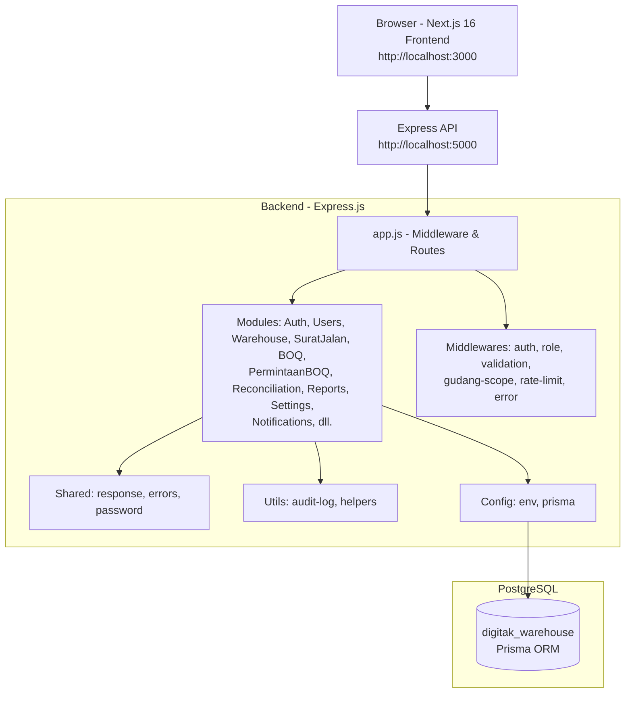

# 01 - Arsitektur Sistem

## Gambaran Umum Sistem

Digitak Warehouse adalah sistem manajemen gudang internal Digitak Studio untuk mengelola proses gudang (inbound, outbound, putaway, delivery, BOQ, rekonsiliasi, return, approval). Sistem dibangun dengan arsitektur terpisah (separate frontend-backend): backend REST API berbasis Express.js + Prisma ORM dengan PostgreSQL, frontend web berbasis Next.js 16 (App Router) dengan TypeScript dan Tailwind CSS. Autentikasi berbasis JWT dengan access token + refresh token, dukungan RBAC berdasarkan role (`admin_general`, `supervisor`, `staf_gudang`) dan scope gudang (user-gudang). Sistem mencatat audit log untuk transaksi penting dan menerapkan rate limiting pada endpoint sensitif.

## Diagram Arsitektur (Mermaid)



## Struktur Folder dan Fungsi

### Backend (`backend/`)
- **`src/server.js`**: Entry point HTTP server. Memuat env, inisialisasi Prisma connect, menjalankan `app.listen()` di `PORT` (default 5000). Error handling koneksi DB.
- **`src/app.js`**: Konfigurasi Express (CORS dengan whitelist allowed origins, JSON parser, cookie-parser, morgan dev, static `/uploads`, security headers dasar, trust proxy config, JSON bigint serializer, health check `/`, register semua route modules, error handler terakhir).
- **`src/config/`**: Konfigurasi aplikasi.
  - `env.js` — validasi dan export env (PORT, DATABASE_URL, JWT_SECRET, JWT_REFRESH_SECRET, JWT_REFRESH_EXPIRES, JWT_ACCESS_EXPIRES, NODE_ENV).
  - `prisma.js` — singleton PrismaClient.
- **`src/middlewares/`**: Middleware request/response.
  - `auth.middleware.js` — autentikasi Bearer JWT, validasi token, cek user aktif (`user_account.is_aktif`), lanjutkan ke `require-password-change.middleware.js`.
  - `role.middleware.js` — autorisasi berbasis role (aliases: `admin_general->ADMIN`, `supervisor->SUPERVISOR`, `staf_gudang->STAFF`). Audit log pada role mismatch (best-effort).
  - `validation.middleware.js` — validasi request body/query/params dengan Zod schema.
  - `gudang-scope.middleware.js` — attach scope gudang (berdasarkan mapping user-gudang) untuk pembatasan akses data per gudang.
  - `require-password-change.middleware.js` — memaksa ubah password jika `must_change_password=true` (path tertentu dikecualikan: `/api/auth/change-password`, `/logout`, `/me`, `/refresh`).
  - `rate-limit.js` — rate limiter terpisah untuk login, password reset, refresh, upload, delete (menggunakan express-rate-limit).
  - `error.middleware.js` — global error handler.
- **`src/modules/`**: Domain modules (feature-based). Setiap module umumnya memiliki: `*.routes.js`, `*.controller.js`, `*.service.js`, `*.repository.js`, `*.validation.js`, `*.mapper.js` (opsional), `*.test.js` (unit test). Modules teridentifikasi: `auth`, `users`, `warehouse` (gudang/zona/aisle), `titik-lapangan`, `aisle`, `category`, `customer`, `item`, `personnel`, `projects`, `supplier`, `unit`, `vehicle`, `zone`, `dashboard`, `profile`, `surat-jalan`, `upload`, `boq`, `cluster`, `permintaan-boq`, `reports`, `reconciliation`, `notifications`, `settings`, `additional` (additional-adjustments), `return`, `capacity`.
- **`src/shared/`**: Utilitas bersama.
  - `response.js` — helper response standar.
  - `errors.js` — class `AppError`.
  - `password.js` — hash/compare password (bcrypt).
  - `logger.js` — logger sederhana.
- **`src/utils/`**: Utility fungsional (contoh `audit-log.js`).
- **`src/validators/`**: Validasi tambahan (jika ada).
- **`src/uploads/`**: Storage file upload (static served).
- **`prisma/`**: Prisma ORM.
  - `schema.prisma` — skema database (PostgreSQL).
  - `migrations/` — migration history.
  - `seed.js`, `seeders/`, `backups/`, `manual/`, `seed-user-gudang.example.sql`.
- **`scripts/dev/`**: Script development/testing (seed-picking-test, verify-picking).

### Frontend (`frontend/`)
- **`app/`** (Next.js App Router): Routing berbasis folder. Struktur teridentifikasi: `layout.tsx`, `page.tsx`, `globals.css`, `shadcn-tailwind.css`, `api/`, `dashboard/`, `forgot-password/`, `master-data/`, `notifications/`, `profile/`, `reset-password/`, `staff/`, `favicon.ico`.
- **`components/`**: UI components (reusable).
- **`lib/`**: Utilities & state.
  - `auth-context.tsx` — Auth context (state user/token/refreshToken, restore session via `/api/auth/me` + fallback refresh, login/logout/updateUser).
  - `permissions.ts`, `navigation.ts` — RBAC mapping frontend (backend role `admin_general|supervisor|staf_gudang` dipetakan ke `admin|supervisor|staff`), konfigurasi navigasi berbasis role.
  - `api.ts`, `utils.ts`, `constants/`, `staff/`, dll.
- **`hooks/`**, **`public/`**, **`docs/`**, **`mocks/`**.
- **Config**: `next.config.ts`, `.env.local`, `AGENTS.md` (Next.js agent notes).

## Alur Autentikasi dan Otorisasi

### Autentikasi (JWT)
- **Login** (`POST /api/auth/login`): validasi body (Zod), rate limited (`loginLimiter`). Service memverifikasi email+password (bcrypt). Jika gagal: audit `login_failed` (alasan `email_not_found`/`account_inactive`/`wrong_password`, email disanitasi). Jika berhasil: generate **access token** (JWT `JWT_SECRET`, expires `JWT_ACCESS_EXPIRES`, default 60m) payload `{ id, email, role, avatar_url }`; generate **refresh token** (JWT `JWT_REFRESH_SECRET`, expires `JWT_REFRESH_EXPIRES`, default 3d), hash SHA256 disimpan ke `refresh_token` (expires_at, ip, user_agent, revoked_at, replaced_by). Response berisi user + access token + refresh token.
- **Refresh** (`POST /api/auth/refresh`, rate limited): validasi refresh token, cek belum revoked/kadaluarsa, cocok hash di DB. Jika valid: revoke token lama (set `revoked_at`, `replaced_by`), generate access token + refresh token baru (rotation). Jika tidak valid: bisa revoke semua refresh token user.
- **Logout** (`POST /api/auth/logout`, butuh auth): bisa menerima `refreshToken` (opsional) dan `userId` dari token. Revoke refresh token spesifik jika dikirim, atau revoke semua active refresh token user jika hanya userId.
- **Me** (`GET /api/auth/me`, butuh auth): mengembalikan data user dari token.
- **Change Password** (`PUT /api/auth/change-password`, butuh auth + validasi): cek password lama, hash baru, update `password_hash`, set `must_change_password=false`, revoke semua active refresh token user. Path ini dikecualikan dari `require-password-change` middleware.
- **Forgot/Reset Password**: `POST /api/auth/forgot-password` (rate limited) — pesan generik. `POST /api/auth/reset-password` (rate limited, validasi): verifikasi token reset, update password, hapus token terkait, revoke semua refresh token user.

**Token/Sesi**: Access token JWT (default 60m) dikirim via `Authorization: Bearer <token>`. Refresh token (default 3d) disimpan terpisah (DB + dikirim client untuk rotation). Middleware `authenticate` memverifikasi access token, set `req.user = decoded`, pastikan user aktif. Middleware `require-password-change` cek `must_change_password` (kecuali path exempt) dan return 403 `MUST_CHANGE_PASSWORD` jika wajib ganti password.

### Otorisasi (RBAC)
- **Roles** (enum `user_role`): `admin_general`, `supervisor`, `staf_gudang`.
- **Aliases mapping** (`role.middleware`): `admin_general->ADMIN`, `supervisor->SUPERVISOR`, `staf_gudang->STAFF`. `authorize(...roles)` membandingkan role ternormalisasi dengan daftar diizinkan. Jika tidak cocok: audit log `access_attempt` (best-effort, entity_type `access_attempt`, aksi `update`) berisi method/url/user_role/required_roles/reason `role_mismatch`, lalu throw `AppError` 403 "Anda tidak memiliki hak akses."
- **Gudang scope** (`gudang-scope.middleware.js`): membatasi akses berdasarkan relasi `user_gudang` (user-gudang_id). Digunakan pada endpoint tertentu (contoh surat-jalan detail/receive-inbound, outbound detail).
- **Frontend mapping** (`lib/navigation.ts`, `lib/permissions.ts`): backend role dipetakan ke `admin|supervisor|staff` untuk UI.

## ERD Sederhana (Mermaid)

```mermaid
erDiagram
  user_account {
    BigInt user_id PK
    String nama
    String email UK
    String password_hash
    user_role role
    Boolean is_aktif
    Boolean must_change_password
    DateTime created_at
    DateTime updated_at
  }

  refresh_token {
    String id PK
    BigInt user_id FK
    String token_hash UK
    DateTime expires_at
    DateTime revoked_at
    String replaced_by
    String ip
    String user_agent
    DateTime created_at
  }

  personil {
    BigInt personil_id PK
    String nama
    personil_jenis jenis
    String no_hp
    String nik UK
    String email UK
    String posisi
    Boolean bisa_menyetir
    Boolean is_material_handler
    String foto
    BigInt user_id UK FK
    BigInt gudang_id FK
    Boolean is_dummy
    Boolean is_aktif
  }

  gudang {
    BigInt gudang_id PK
    String nama_gudang
    gudang_tipe tipe
    String alamat
    BigInt project_id FK
    Boolean is_aktif
    Boolean is_internal
    BigInt pic_id FK
  }

  user_gudang {
    BigInt id PK
    BigInt user_id FK
    BigInt gudang_id FK
  }

  project {
    BigInt project_id PK
    String nama_project
    Boolean status_aktif
  }

  cluster {
    String cluster_id PK
    BigInt project_id FK
    String nama_cluster
    Boolean status_aktif
    BigInt pic_id FK
  }

  zona_gudang {
    BigInt zona_id PK
    BigInt gudang_id FK
    String kode_zona
    String nama_zona
    status_kecukupan_zona status_kecukupan
  }

  barang {
    BigInt barang_id PK
    String kode_barang UK
    String nama_barang
    BigInt category_id FK
    BigInt satuan_id FK
    Boolean is_aktif
  }

  category {
    BigInt category_id PK
    String nama_kategori UK
    String kode_kategori UK
    Boolean is_aktif
  }

  unit {
    BigInt satuan_id PK
    String nama_satuan UK
    String singkatan UK
    Boolean is_aktif
  }

  boq {
    BigInt boq_id PK
    String kode_boq UK
    BigInt project_id FK
    BigInt cluster_id FK
    boq_status status
    boq_source source
    Boolean is_aktif
  }

  boq_item {
    BigInt boq_item_id PK
    BigInt boq_id FK
    BigInt barang_id FK
    BigInt gudang_id FK
    BigInt cluster_id FK
    Decimal qty_total
    Decimal qty_digunakan
    Decimal qty_sisa
  }

  surat_jalan {
    BigInt surat_jalan_id PK
    String no_surat_jalan UK
    surat_jalan_tipe tipe
    surat_jalan_status status
    BigInt gudang_asal_id FK
    BigInt gudang_tujuan_id FK
    BigInt project_id FK
    BigInt cluster_id FK
    BigInt kendaraan_id FK
    BigInt pengantar_id FK
    DateTime tanggal_pengiriman
  }

  surat_jalan_item {
    BigInt surat_jalan_item_id PK
    BigInt surat_jalan_id FK
    BigInt barang_id FK
    BigInt zona_id FK
    BigInt cluster_id FK
    Decimal qty_dikirim
    Decimal qty_diterima
    kondisi_barang kondisi
  }

  stok_gudang {
    BigInt stok_id PK
    BigInt gudang_id FK
    BigInt zona_id FK
    BigInt barang_id FK
    BigInt project_id FK
    Decimal qty_tersedia
    Decimal qty_reservasi
    Decimal qty_dalam_perjalanan
    Decimal qty_rusak
  }

  stok_ledger {
    BigInt ledger_id PK
    BigInt gudang_id FK
    BigInt zona_id FK
    BigInt barang_id FK
    BigInt cluster_id FK
    BigInt surat_jalan_id FK
    mutasi_jenis jenis_mutasi
    Decimal qty
    String referensi
    DateTime created_at
  }

  audit_log {
    BigInt log_id PK
    String entity_type
    BigInt entity_id
    audit_aksi aksi
    BigInt actor_id FK
    Json data_sebelum
    Json data_sesudah
    DateTime created_at
  }

  approval_log {
    BigInt approval_id PK
    approval_entity_type entity_type
    BigInt entity_id
    approval_tahap tahap
    approval_status status
    String alasan
    BigInt actor_id FK
    DateTime created_at
  }

  user_account ||--o{ refresh_token : "memiliki"
  user_account ||--o{ personil : "terkait"
  user_account ||--o{ user_gudang : "terdaftar"
  user_account ||--o{ audit_log : "bertindak"
  user_account ||--o{ approval_log : "menyetujui"
  gudang ||--o{ user_gudang : "memiliki"
  gudang ||--o{ zona_gudang : "memiliki"
  gudang ||--o{ stok_gudang : "menyimpan"
  project ||--o{ cluster : "memiliki"
  cluster ||--o{ boq : "terkait"
  boq ||--o{ boq_item : "memiliki"
  surat_jalan ||--o{ surat_jalan_item : "memiliki"
```

> Catatan: ERD di atas bersifat ringkas (tabel utama domain gudang). Tabel tambahan (return_transaction, additional_adjustment, reconciliation_remains_note, laporan_mitra, tiket_material, zona_utilisasi_log, surat_jalan_transit, password_reset_token, notification, dll.) ada di schema lengkap namun tidak ditampilkan untuk menjaga ringkas sesuai instruksi.

## Alur Data Utama

### Alur Autentikasi & Session
1. User login via `POST /api/auth/login` (validasi + rate limit).
2. Backend verifikasi kredensial → generate access token (JWT, 60m) + refresh token (3d, hash disimpan DB).
3. Frontend simpan token/refreshToken/user di localStorage, AuthContext restore session dengan `GET /api/auth/me` (fallback refresh jika 401/403).
4. Request terproteksi menggunakan `Bearer <access_token>` melalui `auth.middleware.js`; role dicek via `role.middleware.js`; scope gudang via `gudang-scope.middleware.js` jika diperlukan.
5. Jika `must_change_password=true`, middleware blokir request non-exempt dengan 403 `MUST_CHANGE_PASSWORD`.
6. Refresh token rotation saat `/api/auth/refresh` (revoke lama, issue baru). Logout merevoke refresh token(s).

### Alur Data Transaksi Inti (Surat Jalan / Inbound-Outbound)
1. **Pembuatan Surat Jalan** (`POST /api/surat-jalan`, auth + role ADMIN/STAFF): validasi, buat `surat_jalan` + `surat_jalan_item`. Status awal sesuai flow.
2. **Approval (Outbound kritis)**: bisa memerlukan approval (tercatat di `approval_log` entity `surat_jalan`, tahap terkait). Endpoint approval tersedia (contoh `PUT /:id/approve-outbound`, auth SUPERVISOR).
3. **Penerimaan Inbound** (`POST /api/surat-jalan/:id/receive-inbound`, auth + attachGudangScope + validasi): update qty diterima per item, status SJ, audit log `receive_inbound`, update stok (`stok_gudang`) + `stok_ledger` (mutasi `in`), referensi SJ.
4. **Putaway/Retrieve** (`PUT /:id/putaway`, `PUT /:id/retrieve`): pemindahan antar zona, update zona item/stok, audit log `putaway`/`retrieve`.
5. **Delivery/Distribusi (outbound)**: approval → distribusi → update status, mutasi keluar (`stok_ledger` jenis `out`), penyesuaian stok, audit log terkait (`approve_outbound`, `confirm_distributed`, `start_delivery`, `report_arrival`, `tiba_di_transit`, `lanjut_dari_transit`).
6. **BOQ & Permintaan BOQ**: `boq` (draft/aktif/ditolak, top_down/bottom_up) dengan `boq_item` (qty_total/qty_digunakan/qty_sisa). `permintaan_boq` alur diajukan/ditinjau/disetujui/ditolak. Aktivasi BOQ bisa memerlukan approval (tahap `aktivasi_boq`).
7. **Rekonsiliasi**: inventory & filter-options (ADMIN/SUPERVISOR), penyimpanan `reconciliation_remains_note`.

**Catatan**: Mutasi stok terpusat di `stok_gudang` (per gudang+zona+barang+project) dan tercatat di `stok_ledger` (audit trail mutasi dengan referensi SJ/cluster). `audit_log` mencatat aksi penting dengan data sebelum/sesudah (JSON). `approval_log` terpisah untuk proses persetujuan.

TODO: perlu dikonfirmasi - detil transisi status SJ dan mapping lengkap aksi audit per modul (beberapa aksi terdefinisi di enum tapi implementasi bisa diverifikasi lebih lanjut di service level).