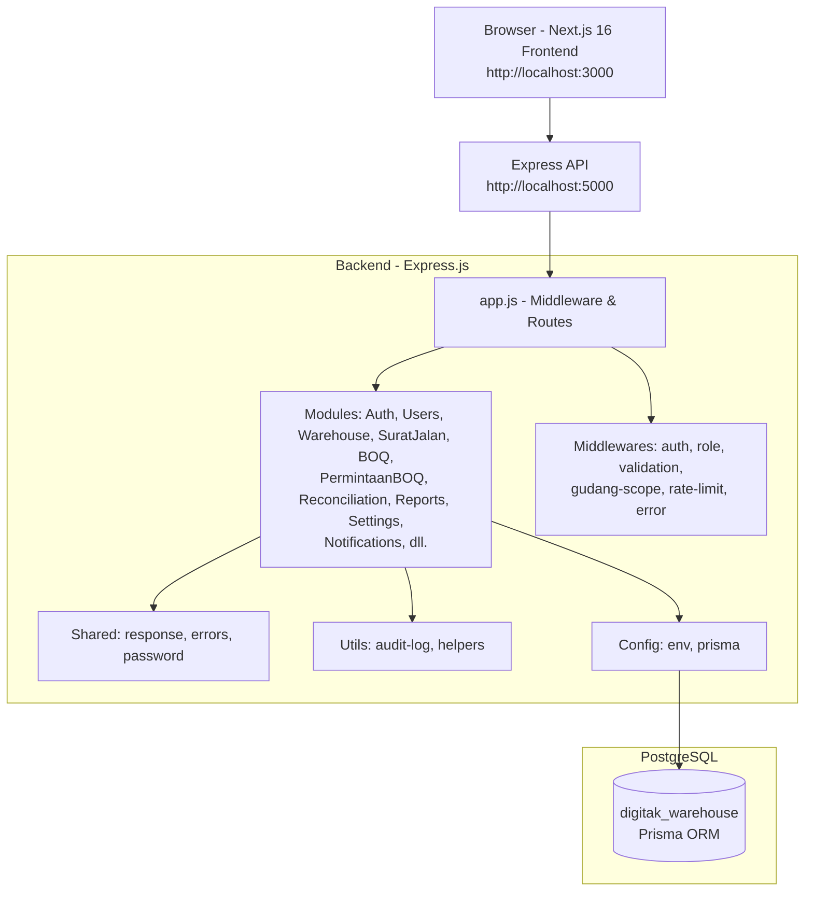

# PROGRESS - TAHAP 1 (Pemetaan Proyek)

## Sub-proyek/Modul
- **backend** (Express.js + Prisma): REST API untuk manajemen gudang, auth, inbound/outbound/putaway/delivery/BOQ/rekonsiliasi, approval berdasarkan role.
- **frontend** (Next.js 16 App Router + TypeScript): Web app untuk UI transaksi gudang, role-based UI, integrasi API backend.

## Tech Stack + Versi Utama
- **Frontend:** Next.js 16.4.2 (App Router), React 19.2.x, TypeScript 5.x, Tailwind CSS 4.x, TanStack Query 5.x, Axios, React Hook Form + Zod 4.x, lucide-react, @base-ui/react, exceljs, react-easy-crop, @react-pdf/renderer, SWR.
- **Backend:** Node.js/Express.js 5.2.1 (CommonJS), Prisma ORM 6.19.3, PostgreSQL (pg), JWT (jsonwebtoken+bcrypt), zod 4.x, express-rate-limit, multer, exceljs/xlsx, morgan, cookie-parser, cors, dotenv.
- **Dev/Test:** nodemon, @next/bundle-analyzer, Playwright (frontend test:e2e/blackbox, root playwright.config.ts), node:test (backend unit tests di `src/**/*.test.js`/`src/modules/**/*.test.js`).

## Database & Schema/Migrasi
- **Database:** PostgreSQL (disebut `digitak_warehouse` di README/README install).
- **ORM/Schema:** Prisma (`backend/prisma/schema.prisma` - belum dibaca; lokasi yang teridentifikasi).
- **Migrasi:** `backend/prisma/migrations/` (lokasi yang teridentifikasi, struktur belum dibaca).
- **Seeder:** `backend/prisma/seed.js` + scripts dev (`scripts/dev/seed-picking-test.js`, `scripts/dev/verify-picking.js`).
- **Lokasi schema/migrasi:** `backend/prisma/` (schema.prisma, migrations/, seed.js).

## File kunci untuk dibaca di tahap berikutnya (TAHAP 2-8)
- **Konfigurasi/Environment:** `backend/.env.example`, `backend/.env`, `frontend/.env.local` (cek variabel penting).
- **Backend Core:** `backend/src/app.js`, `backend/src/server.js`, `backend/src/config/`, `backend/src/middlewares/`, `backend/src/utils/`, `backend/src/validations/`.
- **Routes/Controllers/Models (domain):** `backend/src/routes/*`, `backend/src/controllers/*`, `backend/src/models/*`, `backend/src/modules/*` (jika ada).
- **Prisma:** `backend/prisma/schema.prisma`, `backend/prisma/migrations/` (baca beberapa terbaru), `backend/prisma/seed.js`.
- **Auth/Role:** `backend/src/middlewares/auth*.js`, `backend/src/utils/auth*.js`, `backend/src/config/jwt*.js` (cek).
- **Upload/Storage:** `backend/src/config/upload*`, `backend/src/middlewares/upload*`, `backend/src/routes/upload*`/`controllers/upload*`.
- **Frontend Routes/UI:** `frontend/src/app/` (struktur route grup), `frontend/src/components/`, `frontend/src/lib/`, `frontend/src/hooks/`, `frontend/src/constants/`, `frontend/src/services/`/`frontend/src/api/`.
- **Frontend Auth/Utils:** `frontend/src/lib/auth*`, `frontend/src/hooks/useAuth*`, `frontend/src/middleware.ts` (bila ada).
- **Config lain:** `backend/nodemon.json` (ada), `frontend/next.config.ts` (sudah dibaca), `backend/tsconfig.json` (ada, meski JS project).

## Checklist TAHAP 2-8 (belum dikerjakan)
- [x] TAHAP 2: Menganalisis arsitektur & alur (routes/controllers/services/repo)
- [x] TAHAP 3: Menganalisis model/data (Prisma schema + relasi + enum)
- [x] TAHAP 4: Menganalisis auth & RBAC (JWT, roles, middleware) (grup auth)
- [x] TAHAP 5: Dokumentasi panduan pengguna (frontend UI)
- [x] TAHAP 6: Materi pelatihan singkat
- [x] TAHAP 7: Kebijakan privasi & syarat penggunaan
- [x] TAHAP 8: Finalisasi (docs/README.md, root README.md, daftar TODO/ISI)

TODO: perlu dikonfirmasi - apakah ada file `docker-compose*`, `Dockerfile`, atau `.env.example` di root (tidak ditemukan di root; konfigurasi env terpusat di backend/.env.example).

## API Groups selesai (TAHAP 4)
- [x] auth
- [x] users


## Daftar TODO & [ISI:] yang perlu ditinjau manual (dikumpulkan dari /docs) & [ISI:] yang perlu ditinjau manual (dikumpulkan dari /docs)
- 01-arsitektur.md:
  - # 01 - Arsitektur Sistem

## Gambaran Umum Sistem

Digitak Warehouse adalah sistem manajemen gudang internal Digitak Studio untuk mengelola proses gudang (inbound, outbound, putaway, delivery, BOQ, rekonsiliasi, return, approval). Sistem dibangun dengan arsitektur terpisah (separate frontend-backend): backend REST API berbasis Express.js + Prisma ORM dengan PostgreSQL, frontend web berbasis Next.js 16 (App Router) dengan TypeScript dan Tailwind CSS. Autentikasi berbasis JWT dengan access token + refresh token, dukungan RBAC berdasarkan role (`admin_general`, `supervisor`, `staf_gudang`) dan scope gudang (user-gudang). Sistem mencatat audit log untuk transaksi penting dan menerapkan rate limiting pada endpoint sensitif.

## Diagram Arsitektur (Mermaid)



## Struktur Folder dan Fungsi

### Backend (`backend/`)
- **`src/server.js`**: Entry point HTTP server. Memuat env, inisialisasi Prisma connect, menjalankan `app.listen()` di `PORT` (default 5000). Error handling koneksi DB.
- **`src/app.js`**: Konfigurasi Express (CORS dengan whitelist allowed origins, JSON parser, cookie-parser, morgan dev, static `/uploads`, security headers dasar, trust proxy config, JSON bigint serializer, health check `/`, register semua route modules, error handler terakhir).
- **`src/config/`**: Konfigurasi aplikasi.
  - `env.js` — validasi dan export env (PORT, DATABASE_URL, JWT_SECRET, JWT_REFRESH_SECRET, JWT_REFRESH_EXPIRES, JWT_ACCESS_EXPIRES, NODE_ENV).
  - `prisma.js` — singleton PrismaClient.
- **`src/middlewares/`**: Middleware request/response.
  - `auth.middleware.js` — autentikasi Bearer JWT, validasi token, cek user aktif (`user_account.is_aktif`), lanjutkan ke `require-password-change.middleware.js`.
  - `role.middleware.js` — autorisasi berbasis role (aliases: `admin_general->ADMIN`, `supervisor->SUPERVISOR`, `staf_gudang->STAFF`). Audit log pada role mismatch (best-effort).
  - `validation.middleware.js` — validasi request body/query/params dengan Zod schema.
  - `gudang-scope.middleware.js` — attach scope gudang (berdasarkan mapping user-gudang) untuk pembatasan akses data per gudang.
  - `require-password-change.middleware.js` — memaksa ubah password jika `must_change_password=true` (path tertentu dikecualikan: `/api/auth/change-password`, `/logout`, `/me`, `/refresh`).
  - `rate-limit.js` — rate limiter terpisah untuk login, password reset, refresh, upload, delete (menggunakan express-rate-limit).
  - `error.middleware.js` — global error handler.
- **`src/modules/`**: Domain modules (feature-based). Setiap module umumnya memiliki: `*.routes.js`, `*.controller.js`, `*.service.js`, `*.repository.js`, `*.validation.js`, `*.mapper.js` (opsional), `*.test.js` (unit test). Modules teridentifikasi: `auth`, `users`, `warehouse` (gudang/zona/aisle), `titik-lapangan`, `aisle`, `category`, `customer`, `item`, `personnel`, `projects`, `supplier`, `unit`, `vehicle`, `zone`, `dashboard`, `profile`, `surat-jalan`, `upload`, `boq`, `cluster`, `permintaan-boq`, `reports`, `reconciliation`, `notifications`, `settings`, `additional` (additional-adjustments), `return`, `capacity`.
- **`src/shared/`**: Utilitas bersama.
  - `response.js` — helper response standar.
  - `errors.js` — class `AppError`.
  - `password.js` — hash/compare password (bcrypt).
  - `logger.js` — logger sederhana.
- **`src/utils/`**: Utility fungsional (contoh `audit-log.js`).
- **`src/validators/`**: Validasi tambahan (jika ada).
- **`src/uploads/`**: Storage file upload (static served).
- **`prisma/`**: Prisma ORM.
  - `schema.prisma` — skema database (PostgreSQL).
  - `migrations/` — migration history.
  - `seed.js`, `seeders/`, `backups/`, `manual/`, `seed-user-gudang.example.sql`.
- **`scripts/dev/`**: Script development/testing (seed-picking-test, verify-picking).

### Frontend (`frontend/`)
- **`app/`** (Next.js App Router): Routing berbasis folder. Struktur teridentifikasi: `layout.tsx`, `page.tsx`, `globals.css`, `shadcn-tailwind.css`, `api/`, `dashboard/`, `forgot-password/`, `master-data/`, `notifications/`, `profile/`, `reset-password/`, `staff/`, `favicon.ico`.
- **`components/`**: UI components (reusable).
- **`lib/`**: Utilities & state.
  - `auth-context.tsx` — Auth context (state user/token/refreshToken, restore session via `/api/auth/me` + fallback refresh, login/logout/updateUser).
  - `permissions.ts`, `navigation.ts` — RBAC mapping frontend (backend role `admin_general|supervisor|staf_gudang` dipetakan ke `admin|supervisor|staff`), konfigurasi navigasi berbasis role.
  - `api.ts`, `utils.ts`, `constants/`, `staff/`, dll.
- **`hooks/`**, **`public/`**, **`docs/`**, **`mocks/`**.
- **Config**: `next.config.ts`, `.env.local`, `AGENTS.md` (Next.js agent notes).

## Alur Autentikasi dan Otorisasi

### Autentikasi (JWT)
- **Login** (`POST /api/auth/login`): validasi body (Zod), rate limited (`loginLimiter`). Service memverifikasi email+password (bcrypt). Jika gagal: audit `login_failed` (alasan `email_not_found`/`account_inactive`/`wrong_password`, email disanitasi). Jika berhasil: generate **access token** (JWT `JWT_SECRET`, expires `JWT_ACCESS_EXPIRES`, default 60m) payload `{ id, email, role, avatar_url }`; generate **refresh token** (JWT `JWT_REFRESH_SECRET`, expires `JWT_REFRESH_EXPIRES`, default 3d), hash SHA256 disimpan ke `refresh_token` (expires_at, ip, user_agent, revoked_at, replaced_by). Response berisi user + access token + refresh token.
- **Refresh** (`POST /api/auth/refresh`, rate limited): validasi refresh token, cek belum revoked/kadaluarsa, cocok hash di DB. Jika valid: revoke token lama (set `revoked_at`, `replaced_by`), generate access token + refresh token baru (rotation). Jika tidak valid: bisa revoke semua refresh token user.
- **Logout** (`POST /api/auth/logout`, butuh auth): bisa menerima `refreshToken` (opsional) dan `userId` dari token. Revoke refresh token spesifik jika dikirim, atau revoke semua active refresh token user jika hanya userId.
- **Me** (`GET /api/auth/me`, butuh auth): mengembalikan data user dari token.
- **Change Password** (`PUT /api/auth/change-password`, butuh auth + validasi): cek password lama, hash baru, update `password_hash`, set `must_change_password=false`, revoke semua active refresh token user. Path ini dikecualikan dari `require-password-change` middleware.
- **Forgot/Reset Password**: `POST /api/auth/forgot-password` (rate limited) — pesan generik. `POST /api/auth/reset-password` (rate limited, validasi): verifikasi token reset, update password, hapus token terkait, revoke semua refresh token user.

**Token/Sesi**: Access token JWT (default 60m) dikirim via `Authorization: Bearer <token>`. Refresh token (default 3d) disimpan terpisah (DB + dikirim client untuk rotation). Middleware `authenticate` memverifikasi access token, set `req.user = decoded`, pastikan user aktif. Middleware `require-password-change` cek `must_change_password` (kecuali path exempt) dan return 403 `MUST_CHANGE_PASSWORD` jika wajib ganti password.

### Otorisasi (RBAC)
- **Roles** (enum `user_role`): `admin_general`, `supervisor`, `staf_gudang`.
- **Aliases mapping** (`role.middleware`): `admin_general->ADMIN`, `supervisor->SUPERVISOR`, `staf_gudang->STAFF`. `authorize(...roles)` membandingkan role ternormalisasi dengan daftar diizinkan. Jika tidak cocok: audit log `access_attempt` (best-effort, entity_type `access_attempt`, aksi `update`) berisi method/url/user_role/required_roles/reason `role_mismatch`, lalu throw `AppError` 403 "Anda tidak memiliki hak akses."
- **Gudang scope** (`gudang-scope.middleware.js`): membatasi akses berdasarkan relasi `user_gudang` (user-gudang_id). Digunakan pada endpoint tertentu (contoh surat-jalan detail/receive-inbound, outbound detail).
- **Frontend mapping** (`lib/navigation.ts`, `lib/permissions.ts`): backend role dipetakan ke `admin|supervisor|staff` untuk UI.

## ERD Sederhana (Mermaid)

```mermaid
erDiagram
  user_account {
    BigInt user_id PK
    String nama
    String email UK
    String password_hash
    user_role role
    Boolean is_aktif
    Boolean must_change_password
    DateTime created_at
    DateTime updated_at
  }

  refresh_token {
    String id PK
    BigInt user_id FK
    String token_hash UK
    DateTime expires_at
    DateTime revoked_at
    String replaced_by
    String ip
    String user_agent
    DateTime created_at
  }

  personil {
    BigInt personil_id PK
    String nama
    personil_jenis jenis
    String no_hp
    String nik UK
    String email UK
    String posisi
    Boolean bisa_menyetir
    Boolean is_material_handler
    String foto
    BigInt user_id UK FK
    BigInt gudang_id FK
    Boolean is_dummy
    Boolean is_aktif
  }

  gudang {
    BigInt gudang_id PK
    String nama_gudang
    gudang_tipe tipe
    String alamat
    BigInt project_id FK
    Boolean is_aktif
    Boolean is_internal
    BigInt pic_id FK
  }

  user_gudang {
    BigInt id PK
    BigInt user_id FK
    BigInt gudang_id FK
  }

  project {
    BigInt project_id PK
    String nama_project
    Boolean status_aktif
  }

  cluster {
    String cluster_id PK
    BigInt project_id FK
    String nama_cluster
    Boolean status_aktif
    BigInt pic_id FK
  }

  zona_gudang {
    BigInt zona_id PK
    BigInt gudang_id FK
    String kode_zona
    String nama_zona
    status_kecukupan_zona status_kecukupan
  }

  barang {
    BigInt barang_id PK
    String kode_barang UK
    String nama_barang
    BigInt category_id FK
    BigInt satuan_id FK
    Boolean is_aktif
  }

  category {
    BigInt category_id PK
    String nama_kategori UK
    String kode_kategori UK
    Boolean is_aktif
  }

  unit {
    BigInt satuan_id PK
    String nama_satuan UK
    String singkatan UK
    Boolean is_aktif
  }

  boq {
    BigInt boq_id PK
    String kode_boq UK
    BigInt project_id FK
    BigInt cluster_id FK
    boq_status status
    boq_source source
    Boolean is_aktif
  }

  boq_item {
    BigInt boq_item_id PK
    BigInt boq_id FK
    BigInt barang_id FK
    BigInt gudang_id FK
    BigInt cluster_id FK
    Decimal qty_total
    Decimal qty_digunakan
    Decimal qty_sisa
  }

  surat_jalan {
    BigInt surat_jalan_id PK
    String no_surat_jalan UK
    surat_jalan_tipe tipe
    surat_jalan_status status
    BigInt gudang_asal_id FK
    BigInt gudang_tujuan_id FK
    BigInt project_id FK
    BigInt cluster_id FK
    BigInt kendaraan_id FK
    BigInt pengantar_id FK
    DateTime tanggal_pengiriman
  }

  surat_jalan_item {
    BigInt surat_jalan_item_id PK
    BigInt surat_jalan_id FK
    BigInt barang_id FK
    BigInt zona_id FK
    BigInt cluster_id FK
    Decimal qty_dikirim
    Decimal qty_diterima
    kondisi_barang kondisi
  }

  stok_gudang {
    BigInt stok_id PK
    BigInt gudang_id FK
    BigInt zona_id FK
    BigInt barang_id FK
    BigInt project_id FK
    Decimal qty_tersedia
    Decimal qty_reservasi
    Decimal qty_dalam_perjalanan
    Decimal qty_rusak
  }

  stok_ledger {
    BigInt ledger_id PK
    BigInt gudang_id FK
    BigInt zona_id FK
    BigInt barang_id FK
    BigInt cluster_id FK
    BigInt surat_jalan_id FK
    mutasi_jenis jenis_mutasi
    Decimal qty
    String referensi
    DateTime created_at
  }

  audit_log {
    BigInt log_id PK
    String entity_type
    BigInt entity_id
    audit_aksi aksi
    BigInt actor_id FK
    Json data_sebelum
    Json data_sesudah
    DateTime created_at
  }

  approval_log {
    BigInt approval_id PK
    approval_entity_type entity_type
    BigInt entity_id
    approval_tahap tahap
    approval_status status
    String alasan
    BigInt actor_id FK
    DateTime created_at
  }

  user_account ||--o{ refresh_token : "memiliki"
  user_account ||--o{ personil : "terkait"
  user_account ||--o{ user_gudang : "terdaftar"
  user_account ||--o{ audit_log : "bertindak"
  user_account ||--o{ approval_log : "menyetujui"
  gudang ||--o{ user_gudang : "memiliki"
  gudang ||--o{ zona_gudang : "memiliki"
  gudang ||--o{ stok_gudang : "menyimpan"
  project ||--o{ cluster : "memiliki"
  cluster ||--o{ boq : "terkait"
  boq ||--o{ boq_item : "memiliki"
  surat_jalan ||--o{ surat_jalan_item : "memiliki"
```

> Catatan: ERD di atas bersifat ringkas (tabel utama domain gudang). Tabel tambahan (return_transaction, additional_adjustment, reconciliation_remains_note, laporan_mitra, tiket_material, zona_utilisasi_log, surat_jalan_transit, password_reset_token, notification, dll.) ada di schema lengkap namun tidak ditampilkan untuk menjaga ringkas sesuai instruksi.

## Alur Data Utama

### Alur Autentikasi & Session
1. User login via `POST /api/auth/login` (validasi + rate limit).
2. Backend verifikasi kredensial → generate access token (JWT, 60m) + refresh token (3d, hash disimpan DB).
3. Frontend simpan token/refreshToken/user di localStorage, AuthContext restore session dengan `GET /api/auth/me` (fallback refresh jika 401/403).
4. Request terproteksi menggunakan `Bearer <access_token>` melalui `auth.middleware.js`; role dicek via `role.middleware.js`; scope gudang via `gudang-scope.middleware.js` jika diperlukan.
5. Jika `must_change_password=true`, middleware blokir request non-exempt dengan 403 `MUST_CHANGE_PASSWORD`.
6. Refresh token rotation saat `/api/auth/refresh` (revoke lama, issue baru). Logout merevoke refresh token(s).

### Alur Data Transaksi Inti (Surat Jalan / Inbound-Outbound)
1. **Pembuatan Surat Jalan** (`POST /api/surat-jalan`, auth + role ADMIN/STAFF): validasi, buat `surat_jalan` + `surat_jalan_item`. Status awal sesuai flow.
2. **Approval (Outbound kritis)**: bisa memerlukan approval (tercatat di `approval_log` entity `surat_jalan`, tahap terkait). Endpoint approval tersedia (contoh `PUT /:id/approve-outbound`, auth SUPERVISOR).
3. **Penerimaan Inbound** (`POST /api/surat-jalan/:id/receive-inbound`, auth + attachGudangScope + validasi): update qty diterima per item, status SJ, audit log `receive_inbound`, update stok (`stok_gudang`) + `stok_ledger` (mutasi `in`), referensi SJ.
4. **Putaway/Retrieve** (`PUT /:id/putaway`, `PUT /:id/retrieve`): pemindahan antar zona, update zona item/stok, audit log `putaway`/`retrieve`.
5. **Delivery/Distribusi (outbound)**: approval → distribusi → update status, mutasi keluar (`stok_ledger` jenis `out`), penyesuaian stok, audit log terkait (`approve_outbound`, `confirm_distributed`, `start_delivery`, `report_arrival`, `tiba_di_transit`, `lanjut_dari_transit`).
6. **BOQ & Permintaan BOQ**: `boq` (draft/aktif/ditolak, top_down/bottom_up) dengan `boq_item` (qty_total/qty_digunakan/qty_sisa). `permintaan_boq` alur diajukan/ditinjau/disetujui/ditolak. Aktivasi BOQ bisa memerlukan approval (tahap `aktivasi_boq`).
7. **Rekonsiliasi**: inventory & filter-options (ADMIN/SUPERVISOR), penyimpanan `reconciliation_remains_note`.

**Catatan**: Mutasi stok terpusat di `stok_gudang` (per gudang+zona+barang+project) dan tercatat di `stok_ledger` (audit trail mutasi dengan referensi SJ/cluster). `audit_log` mencatat aksi penting dengan data sebelum/sesudah (JSON). `approval_log` terpisah untuk proses persetujuan.

TODO: perlu dikonfirmasi - detil transisi status SJ dan mapping lengkap aksi audit per modul (beberapa aksi terdefinisi di enum tapi implementasi bisa diverifikasi lebih lanjut di service level).
- 06-kebijakan-privasi.md:
  - # 06 - Kebijakan Privasi

> DRAF - Perlu ditinjau oleh pihak hukum/manajemen sebelum dipublikasikan. Dokumen ini disusun berdasarkan temuan pada skema database (Prisma schema) dan implementasi yang relevan di kode. Isi dapat disesuaikan dengan praktik operasional organisasi.

## 1. Data Apa yang Dikumpulkan dan Tujuannya

Berdasarkan temuan schema, sistem dapat menyimpan data pribadi berikut:

| Data Pribadi | Sumber | Tujuan Pengumpulan |
|---|---|---|
| Nama | user_account.nama, personil.nama, pengirim_eksternal_nama, driver_nama_teks, kendaraan_nama_teks, pic_pemohon_nama | Identifikasi pengguna, penanggung jawab, pengemudi/pemohon untuk operasional gudang & audit |
| Email | user_account.email (unik), personil.email (unik, opsional), email_reference | Autentikasi, komunikasi terkait akun, referensi audit |
| No HP | personil.no_hp (opsional) | Kontak operasional personil |
| Alamat | gudang.alamat, titik_lapangan.alamat, cluster.alamat_lengkap, alamat_lapangan, customer.alamat, supplier.alamat | Lokasi fisik gudang/titik lapangan/klien untuk operasional gudang |
| Foto | user_account/personil/kendaraan/barang.foto, foto_url | Identifikasi visual (foto profil/kendaraan/barang) sesuai kebutuhan operasional |
| IP Address | refresh_token.ip (dicatat saat login/refresh token) | Keamanan (deteksi sesi tidak biasa) & audit |
| User Agent | refresh_token.user_agent | Keamanan sesi & audit |
| Log Aktivitas/Audit | audit_log (entity_type, entity_id, aksi, actor_id, data_sebelum, data_sesudah, created_at) | Jejak audit, investigasi insiden, kepatuhan |
| Data Notifikasi | notification (user_id, role, type, title, message, link, is_read, read_at, created_at) | Penyampaian notifikasi operasional |
| Data Preferensi Notifikasi | user_notification_preferences (user_id, category, enabled) | Pengaturan notifikasi per pengguna |
| Data Reset Password | password_reset_token (email, token, expires, createdAt) | Proses pemulihan akses akun |
| Sesi/Token | refresh_token (token_hash, expires_at, revoked_at, replaced_by, ip, user_agent) | Manajemen sesi & keamanan autentikasi |

## 2. Dasar Pemrosesan, Masa Retensi, dan Siapa yang Bisa Mengakses Data

- **Dasar Pemrosesan**: Pemrosesan data dilakukan untuk mendukung operasional gudang (inbound/outbound/putaway/delivery/BOQ/rekonsiliasi/approval), autentikasi & otorisasi, keamanan sistem, audit, dan kepatuhan internal.
- **Masa Retensi** (berdasarkan pola field created_at/updated_at/expires):
  - Data akun aktif: disimpan selama akun aktif dan sesuai kebutuhan operasional.
  - Log audit (udit_log): umumnya dipertahankan untuk keperluan audit dan investigasi; [ISI: kebijakan retensi spesifik - tentukan periode, mis. 1-7 tahun sesuai kebutuhan kepatuhan].
  - Refresh token: disimpan hingga kadaluarsa (expires_at) atau dicabut (
evoked_at) atau digantikan (
eplaced_by).
  - Password reset token: disimpan hingga kadaluarsa (expires) atau digunakan (dihapus setelah penggunaan).
  - Notifikasi: [ISI: periode retensi notifikasi sesuai kebijakan organisasi].
  - Data operasional (transaksi gudang): [ISI: sesuai kebutuhan hukum/akuntansi organisasi].
- **Akses Data**:
  - Admin (role dmin_general) - akses luas sesuai kebutuhan administratif & konfigurasi.
  - Supervisor (role supervisor) - akses sesuai wewenang operasional/persetujuan.
  - Staf Gudang (role staf_gudang) - akses terbatas sesuai tugas lapangan.
  - Sistem/Service internal (backend service) - akses melalui kontrol akses berbasis role dan gudang scope.
  - [ISI: pihak ketiga - jika ada, sebutkan dan dasar aksesnya].

## 3. Keamanan Data

Berdasarkan temuan implementasi:
- **Enkripsi Password**: Password disimpan sebagai password_hash (bcrypt) di user_account. Tidak disimpan dalam bentuk plaintext.
- **Sesi & Token**: Menggunakan JWT untuk access token (signed dengan JWT_SECRET) dan refresh token disimpan ter-hash (
efresh_token.token_hash, SHA256). Refresh token menerapkan rotasi (token lama di-revoke saat refresh).
- **Kontrol Akses**: 
  - Autentikasi wajib untuk endpoint terlindungi (uth.middleware.js)
  - Otorisasi berbasis role (
ole.middleware.js) - mapping role backend ke frontend
  - Pembatasan scope gudang (gudang-scope.middleware.js) untuk membatasi akses data per gudang
  - 
equire-password-change.middleware.js untuk memaksa ubah password jika diperlukan
- **Keamanan Lainnya**:
  - Rate limiting pada endpoint sensitif (login, forgot/reset password, refresh, upload, delete) - dikonfigurasi via env
  - Validasi input (Zod validation) di berbagai modul
  - Penanganan CORS dengan whitelist allowed origins (hardcoded di pp.js)
  - Security headers dasar (X-Content-Type-Options, Referrer-Policy)
  - JSON bigint serializer untuk mencegah masalah serialisasi
  - Audit logging untuk aksi penting (login success/failed, transaksi kunci, dll.)
- **Catatan Keamanan**: [ISI: kebijakan tambahan (backup, monitoring, incident response) sesuai organisasi].

## 4. Hak Pengguna (sesuai UU No. 27 Tahun 2022 tentang Pelindungan Data Pribadi)

Berdasarkan ketentuan UU PDP, pengguna memiliki hak sebagai berikut:
- **Hak untuk mendapatkan informasi** tentang pemrosesan data pribadi.
- **Hak akses** atas data pribadi yang disimpan.
- **Hak perbaikan/koreksi** atas data pribadi yang tidak akurat atau tidak lengkap.
- **Hak penghapusan** atas data pribadi tertentu (dengan mempertimbangkan kewajiban retensi hukum).
- **Hak pembatasan pemrosesan** dalam kondisi tertentu.
- **Hak keberatan** atas pemrosesan data pribadi.
- **Hak atas portabilitas data** (jika relevan).
- **Hak untuk menarik persetujuan** yang diberikan.
- **Hak mengajukan pengaduan** ke otoritas pelindungan data pribadi.

**Cara Menghubungi Admin**: [ISI: nama kontak admin/koordinator PDP, email, nomor telepon, unit kerja]

## 5. Penutup

Kebijakan ini dapat diperbarui sewaktu-waktu sesuai kebutuhan dan perkembangan peraturan. Perubahan akan diinformasikan melalui saluran resmi organisasi.

[Nama Organisasi] - [ISI: nama lengkap organisasi]  
[Alamat Organisasi] - [ISI: alamat]
- 07-syarat-penggunaan.md:
  - # 07 - Syarat Penggunaan

> DRAF - Perlu ditinjau oleh pihak hukum/manajemen sebelum dipublikasikan. Dokumen ini merupakan syarat penggunaan layanan sistem Digitak Warehouse dan perlu disesuaikan dengan kebijakan organisasi.

## 1. Ruang Lingkup Layanan

Sistem Digitak Warehouse (selanjutnya disebut "Sistem") adalah aplikasi berbasis web untuk mengelola operasional gudang internal. Layanan ini ditujukan untuk penggunaan internal oleh [ISI: Nama Organisasi] dan hanya boleh digunakan oleh pengguna yang telah terdaftar dan diberi akses sesuai perannya.

## 2. Kewajiban Pengguna

Pengguna wajib:
- Menggunakan Sistem sesuai peran dan wewenang yang diberikan.
- Menjaga kerahasiaan kredensial akun (email, kata sandi).
- Menggunakan kata sandi yang kuat dan tidak membagikannya kepada pihak lain.
- Segera melaporkan kepada Admin jika menduga akun telah disalahgunakan.
- Memasukkan data yang benar, akurat, dan terkini.
- Menggunakan Sistem sesuai prosedur dan peraturan organisasi yang berlaku.
- Mematuhi ketentuan hukum dan perundang-undangan yang berlaku.

## 3. Larangan

Pengguna dilarang:
- Mengakses atau mencoba mengakses bagian Sistem yang bukan wewenangnya.
- Menyalin, mendistribusikan, atau memanfaatkan data Sistem untuk tujuan di luar kepentingan operasional organisasi tanpa izin tertulis.
- Melakukan upaya peretasan, injeksi, atau tindakan yang dapat merusak/mengganggu Sistem.
- Mencoba memperoleh akses tidak sah ke akun orang lain.
- Menyebarkan malware atau kode berbahaya melalui Sistem.
- Melakukan tindakan lain yang dapat merugikan organisasi, pengguna lain, atau integritas data Sistem.

## 4. Tanggung Jawab Akun

- Setiap akun hanya boleh digunakan oleh pemilik yang sah.
- Pengguna bertanggung jawab atas seluruh aktivitas yang terjadi melalui akunnya.
- Pengguna wajib menjaga keamanan perangkat yang digunakan untuk mengakses Sistem.
- Jika terjadi pelanggaran, organisasi berhak menonaktifkan akun sementara/permanen sesuai kebijakan.

## 5. Pembatasan Tanggung Jawab

Sistem disediakan "sebagaimana adanya" untuk keperluan internal. Organisasi tidak bertanggung jawab atas:
- Kerugian langsung/tidak langsung akibat penggunaan Sistem di luar prosedur yang ditetapkan.
- Gangguan layanan akibat force majeure (bencana alam, gangguan jaringan provider, dll.).
- Kehilangan data akibat kelalaian pengguna dalam menjaga kredensial atau kelalaian prosedural.
- Kerugian akibat penggunaan tidak sah oleh pihak ketiga akibat kelalaian pengguna.

## 6. Perubahan Ketentuan

Organisasi berhak mengubah ketentuan ini sewaktu-waktu. Perubahan akan diinformasikan melalui saluran resmi organisasi. Pengguna dianggap menyetujui perubahan tersebut dengan tetap menggunakan Sistem setelah perubahan diumumkan.

## 7. Kontak

Pertanyaan terkait syarat penggunaan ini dapat diajukan ke:  
Bapak Apriadi
PT Metanouva Informatika (Digitak Studio)  
Email: info@digitak.id
Telepon: +62 877-8052-3063

