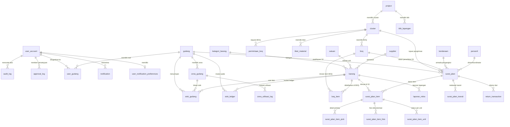

# Spesifikasi Model Data — Digitak Warehouse Management System

> **Dokumen Pendukung PRD** — Bab 10 (Model Data & Skema Database)
> **Sumber Data:** `backend/prisma/schema.prisma`
> **Dialek Database:** PostgreSQL (Prisma ORM)
> **Jumlah Model/Tabel:** 37 model
> **Jumlah Enum:** 23 enum

---

## 1. Diagram Relasi Entitas (ERD)

---

## 2. Daftar Enum Database (23 Enum)

### Enum `jenis_laporan_enum`

| Nilai (Value) |
|---|
| `excel` |
| `manual` |
| `migrasi_sistem` |

### Enum `reconciliation_detail_status`

| Nilai (Value) |
|---|
| `berhasil` |
| `gagal` |

### Enum `user_role`

| Nilai (Value) |
|---|
| `admin_general` |
| `supervisor` |
| `staf_gudang` |

### Enum `personil_jenis`

| Nilai (Value) |
|---|
| `teknisi` |
| `admin_gudang` |
| `pengantar_logistik` |

### Enum `gudang_tipe`

| Nilai (Value) |
|---|
| `tetap` |
| `dadakan` |

### Enum `tujuan_tipe_enum`

| Nilai (Value) |
|---|
| `lapangan` |
| `gudang` |

### Enum `tipe_pengirim_enum`

| Nilai (Value) |
|---|
| `internal` |
| `external` |

### Enum `boq_status`

| Nilai (Value) |
|---|
| `draft` |
| `aktif` |
| `selesai` |
| `ditolak` |

### Enum `boq_source`

| Nilai (Value) |
|---|
| `top_down` |
| `bottom_up` |

### Enum `external_verification_status`

| Nilai (Value) |
|---|
| `terverifikasi` |
| `menunggu` |
| `tidak_berlaku` |

### Enum `permintaan_boq_status`

| Nilai (Value) |
|---|
| `diajukan` |
| `ditinjau` |
| `disetujui` |
| `ditolak` |

### Enum `surat_jalan_tipe`

| Nilai (Value) |
|---|
| `inbound` |
| `outbound` |

### Enum `surat_jalan_status`

| Nilai (Value) |
|---|
| `draft_diajukan` |
| `menunggu_verifikasi` |
| `ready_putaway` |
| `disetujui` |
| `sedang_dikirim` |
| `tiba_di_transit` |
| `tiba_menunggu_konfirmasi` |
| `diterima_didistribusikan` |
| `ditolak` |
| `digenerate` |

### Enum `kondisi_barang`

| Nilai (Value) |
|---|
| `baik` |
| `rusak_ringan` |
| `rusak_berat` |
| `tidak_sesuai_spek` |
| `doa` |

### Enum `mutasi_jenis`

| Nilai (Value) |
|---|
| `in` |
| `out` |

### Enum `return_status`

| Nilai (Value) |
|---|
| `draft` |
| `diajukan` |
| `disetujui` |
| `diterima_gudang` |
| `ditolak` |

### Enum `approval_entity_type`

| Nilai (Value) |
|---|
| `boq` |
| `surat_jalan` |
| `return_transaction` |

### Enum `approval_tahap`

| Nilai (Value) |
|---|
| `aktivasi_boq` |
| `inbound_verifikasi` |
| `inbound_putaway` |
| `outbound_approval` |
| `outbound_delivery` |
| `outbound_kritis` |
| `outbound_di_luar_boq` |
| `outbound_melebihi_remains` |
| `return_approval` |
| `return_receive` |

### Enum `approval_status`

| Nilai (Value) |
|---|
| `menunggu` |
| `disetujui` |
| `ditolak` |

### Enum `status_kecukupan_zona`

| Nilai (Value) |
|---|
| `CUKUP` |
| `MENDEKATI_PENUH` |
| `TIDAK_CUKUP` |

### Enum `status_kecukupan_source`

| Nilai (Value) |
|---|
| `AUTO` |
| `MANUAL` |

### Enum `audit_aksi`

| Nilai (Value) |
|---|
| `create` |
| `update` |
| `delete` |
| `approve` |
| `receive_inbound` |
| `approve_inbound` |
| `approve_outbound` |
| `confirm_distributed` |
| `reject_inbound` |
| `reject_outbound` |
| `putaway` |
| `retrieve` |
| `create_inbound` |
| `create_outbound` |
| `start_delivery` |
| `report_arrival` |
| `tiba_di_transit` |
| `lanjut_dari_transit` |
| `nonaktifkan_project` |
| `aktifkan_project` |
| `soft_delete` |
| `restore` |
| `input_rekonsiliasi` |

### Enum `notification_type`

| Nilai (Value) |
|---|
| `info` |
| `approval` |
| `warning` |
| `success` |
| `error` |

---

## 3. Spesifikasi Detail Entitas (37 Model)

### 1. Model `user_account`

| Nama Kolom | Tipe Data | Keterangan / Constraint / Relasi |
|---|---|---|
| `user_id` | `BigInt` | @id @default(autoincrement()) |
| `nama` | `String` | - |
| `email` | `String` | @unique |
| `password_hash` | `String` | - |
| `role` | `user_role` | - |
| `is_aktif` | `Boolean` | @default(true) |
| `must_change_password` | `Boolean` | @default(false) |
| `created_at` | `DateTime` | @default(now()) |
| `updated_at` | `DateTime` | @default(now()) |
| `approval_logs` | `approval_log[]` | - |
| `audit_logs` | `audit_log[]` | - |
| `created_barangs` | `barang[]` | @relation("barang_created_by") |
| `updated_barangs` | `barang[]` | @relation("barang_updated_by") |
| `created_boqs` | `boq[]` | @relation("boq_created_by") |
| `boq_diaktifkan_oleh` | `boq[]` | @relation("boq_diaktifkan") |
| `updated_boqs` | `boq[]` | @relation("boq_updated_by") |
| `created_gudangs` | `gudang[]` | @relation("gudang_created_by") |
| `updated_gudangs` | `gudang[]` | @relation("gudang_updated_by") |
| `created_kendaraans` | `kendaraan[]` | @relation("kendaraan_created_by") |
| `updated_kendaraans` | `kendaraan[]` | @relation("kendaraan_updated_by") |
| `personil_creator` | `personil[]` | @relation("personil_created_by") |
| `personil_updater` | `personil[]` | @relation("personil_updated_by") |
| `personils` | `personil?` | - |
| `created_projects` | `project[]` | @relation("project_created_by") |
| `updated_projects` | `project[]` | @relation("project_updated_by") |
| `created_titik_lapangans` | `titik_lapangan[]` | @relation("titik_lapangan_created_by") |
| `updated_titik_lapangans` | `titik_lapangan[]` | @relation("titik_lapangan_updated_by") |
| `created_surat_jalans` | `surat_jalan[]` | @relation("surat_jalan_created_by") |
| `updated_surat_jalans` | `surat_jalan[]` | @relation("surat_jalan_updated_by") |
| `surat_jalan_dilaporkan_tiba` | `surat_jalan[]` | @relation("surat_jalan_dilaporkan_tiba_oleh") |
| `surat_jalan_dikonfirmasi_tiba` | `surat_jalan[]` | @relation("surat_jalan_dikonfirmasi_oleh") |
| `surat_jalan_transit_tiba` | `surat_jalan_transit[]` | @relation("surat_jalan_transit_tiba_oleh") |
| `surat_jalan_transit_berangkat` | `surat_jalan_transit[]` | @relation("surat_jalan_transit_berangkat_oleh") |
| `created_tiket_materials` | `tiket_material[]` | @relation("tiket_material_created_by") |
| `zona_utilisasi_logs` | `zona_utilisasi_log[]` | @relation("zona_utilisasi_log_updater") |
| `zona_dinilai_oleh` | `zona_gudang[]` | @relation("ZonaGudangDinilaiOleh") |
| `surat_jalan_item_diperiksa_oleh` | `surat_jalan_item[]` | @relation("SuratJalanItemDiperiksaOleh") |
| `reconciliation_upload_logs` | `reconciliation_upload_log[]` | @relation("ReconciliationUploadLogActor") |
| `laporan_mitras` | `laporan_mitra[]` | @relation("LaporanMitraUploader") |
| `notifications` | `notification[]` | - |
| `notification_preferences` | `user_notification_preferences[]` | - |
| `user_gudangs` | `user_gudang[]` | - |
| `created_return_transactions` | `return_transaction[]` | @relation("ReturnCreatedBy") |
| `approved_return_transactions` | `return_transaction[]` | @relation("ReturnApprovedBy") |
| `received_return_transactions` | `return_transaction[]` | @relation("ReturnReceivedBy") |
| `additional_adjustments` | `additional_adjustment[]` | - |
| `created_reconciliation_remains_notes` | `reconciliation_remains_note[]` | @relation("ReconciliationRemainsNoteCreatedBy") |
| `updated_reconciliation_remains_notes` | `reconciliation_remains_note[]` | @relation("ReconciliationRemainsNoteUpdatedBy") |

**Index & Constraint Tingkat Model:**

- `@@index([email])`

### 2. Model `user_notification_preferences`

| Nama Kolom | Tipe Data | Keterangan / Constraint / Relasi |
|---|---|---|
| `id` | `BigInt` | @id @default(autoincrement()) |
| `user_id` | `BigInt` | - |
| `category` | `String` | - |
| `enabled` | `Boolean` | @default(true) |
| `created_at` | `DateTime` | @default(now()) @db.Timestamptz |
| `updated_at` | `DateTime` | @default(now()) @db.Timestamptz |
| `user` | `user_account` | @relation(fields: [user_id], references: [user_id], onDelete: Cascade) |

**Index & Constraint Tingkat Model:**

- `@@unique([user_id, category])`
- `@@index([user_id])`

### 3. Model `user_gudang`

| Nama Kolom | Tipe Data | Keterangan / Constraint / Relasi |
|---|---|---|
| `id` | `BigInt` | @id @default(autoincrement()) |
| `user_id` | `BigInt` | - |
| `gudang_id` | `BigInt` | - |
| `created_at` | `DateTime` | @default(now()) |
| `gudang` | `gudang` | @relation(fields: [gudang_id], references: [gudang_id], onDelete: Cascade) |
| `user` | `user_account` | @relation(fields: [user_id], references: [user_id], onDelete: Cascade) |

**Index & Constraint Tingkat Model:**

- `@@unique([user_id, gudang_id])`
- `@@index([gudang_id])`
- `@@index([user_id])`

### 4. Model `personil`

| Nama Kolom | Tipe Data | Keterangan / Constraint / Relasi |
|---|---|---|
| `personil_id` | `BigInt` | @id @default(autoincrement()) |
| `nama` | `String` | - |
| `jenis` | `personil_jenis` | - |
| `no_hp` | `String?` | - |
| `nik` | `String?` | @unique |
| `email` | `String?` | @unique |
| `posisi` | `String?` | - |
| `bisa_menyetir` | `Boolean?` | @default(false) |
| `is_material_handler` | `Boolean?` | @default(false) |
| `foto` | `String?` | - |
| `user_id` | `BigInt?` | @unique |
| `gudang_id` | `BigInt?` | - |
| `is_dummy` | `Boolean` | @default(false) |
| `is_aktif` | `Boolean` | @default(true) |
| `created_at` | `DateTime` | @default(now()) |
| `updated_at` | `DateTime` | @default(now()) |
| `created_by` | `BigInt` | - |
| `updated_by` | `BigInt` | - |
| `gudang_pics` | `gudang[]` | @relation("gudang_pic") |
| `cluster_pic` | `cluster[]` | @relation("ClusterPic") |
| `permintaan_boq_diajukan` | `permintaan_boq[]` | @relation("permintaan_diajukan_oleh") |
| `permintaan_boq_ditinjai` | `permintaan_boq[]` | @relation("permintaan_ditinjai_oleh") |
| `creator` | `user_account` | @relation("personil_created_by", fields: [created_by], references: [user_id]) |
| `gudang` | `gudang?` | @relation("personil_gudang", fields: [gudang_id], references: [gudang_id]) |
| `updater` | `user_account` | @relation("personil_updated_by", fields: [updated_by], references: [user_id]) |
| `user` | `user_account?` | @relation(fields: [user_id], references: [user_id]) |
| `surat_jalan_pengantar` | `surat_jalan[]` | - |

**Index & Constraint Tingkat Model:**

- `@@index([user_id])`
- `@@index([nik])`
- `@@index([gudang_id])`

### 5. Model `kendaraan`

| Nama Kolom | Tipe Data | Keterangan / Constraint / Relasi |
|---|---|---|
| `kendaraan_id` | `BigInt` | @id @default(autoincrement()) |
| `no_polisi` | `String` | @unique |
| `jenis_kendaraan` | `String` | - |
| `merk` | `String?` | - |
| `kapasitas_angkut` | `Decimal?` | @db.Decimal(12, 2) |
| `keterangan` | `String?` | - |
| `foto` | `String?` | - |
| `created_at` | `DateTime` | @default(now()) |
| `updated_at` | `DateTime` | @default(now()) |
| `created_by` | `BigInt` | - |
| `updated_by` | `BigInt` | - |
| `gudang_id` | `BigInt?` | - |
| `gudang` | `gudang?` | @relation("kendaraan_gudang", fields: [gudang_id], references: [gudang_id]) |
| `creator` | `user_account` | @relation("kendaraan_created_by", fields: [created_by], references: [user_id]) |
| `updater` | `user_account` | @relation("kendaraan_updated_by", fields: [updated_by], references: [user_id]) |
| `surat_jalans` | `surat_jalan[]` | - |

**Index & Constraint Tingkat Model:**

- `@@index([no_polisi])`
- `@@index([gudang_id])`

### 6. Model `project`

| Nama Kolom | Tipe Data | Keterangan / Constraint / Relasi |
|---|---|---|
| `project_id` | `BigInt` | @id @default(autoincrement()) |
| `nama_project` | `String` | - |
| `title` | `String?` | - |
| `cluster_id` | `String?` | - |
| `area` | `String?` | - |
| `klien` | `String?` | - |
| `kecamatan` | `String?` | - |
| `desa_kelurahan` | `String?` | - |
| `kota_kabupaten` | `String?` | - |
| `provinsi` | `String?` | - |
| `status_aktif` | `Boolean` | @default(true) |
| `created_at` | `DateTime` | @default(now()) |
| `updated_at` | `DateTime` | @default(now()) |
| `created_by` | `BigInt` | - |
| `updated_by` | `BigInt` | - |
| `gudangs` | `gudang[]` | - |
| `permintaan_boqs` | `permintaan_boq[]` | - |
| `creator` | `user_account` | @relation("project_created_by", fields: [created_by], references: [user_id]) |
| `updater` | `user_account` | @relation("project_updated_by", fields: [updated_by], references: [user_id]) |
| `stok_gudangs` | `stok_gudang[]` | - |
| `surat_jalans` | `surat_jalan[]` | - |
| `tiket_materials` | `tiket_material[]` | - |
| `titik_lapangans` | `titik_lapangan[]` | - |
| `laporans` | `laporan_mitra[]` | @relation("LaporanMitraProject") |
| `return_transactions` | `return_transaction[]` | - |
| `clusters` | `cluster[]` | - |
| `additional_adjustments` | `additional_adjustment[]` | - |
| `reconciliation_remains_notes` | `reconciliation_remains_note[]` | - |

**Index & Constraint Tingkat Model:**

- `@@index([area])`

### 7. Model `cluster`

| Nama Kolom | Tipe Data | Keterangan / Constraint / Relasi |
|---|---|---|
| `cluster_id` | `String` | @id @db.Text |
| `project_id` | `BigInt` | - |
| `nama_cluster` | `String` | @db.Text |
| `cluster_type` | `String?` | @db.Text |
| `project_type` | `String?` | @db.Text |
| `kso_partner` | `String?` | @db.Text |
| `kso_contact` | `String?` | @db.Text |
| `no_tiket_release` | `String?` | @db.Text |
| `vendor` | `String?` | @db.Text |
| `alamat_lengkap` | `String?` | @db.Text |
| `homepass_plan` | `Int?` | - |
| `status_aktif` | `Boolean` | @default(true) |
| `created_at` | `DateTime` | @default(now()) |
| `updated_at` | `DateTime` | @default(now()) |
| `created_by` | `BigInt` | - |
| `updated_by` | `BigInt` | - |
| `pic_id` | `BigInt?` | - |
| `project` | `project` | @relation(fields: [project_id], references: [project_id], onDelete: Restrict) |
| `pic` | `personil?` | @relation("ClusterPic", fields: [pic_id], references: [personil_id]) |
| `boqs` | `boq[]` | - |
| `boq_items` | `boq_item[]` | - |
| `surat_jalans_direct` | `surat_jalan[]` | - |
| `surat_jalan_items` | `surat_jalan_item[]` | - |
| `permintaan_boqs` | `permintaan_boq[]` | - |
| `return_transactions` | `return_transaction[]` | @relation("ReturnCluster") |
| `laporans` | `laporan_mitra[]` | @relation("ClusterLaporan") |
| `stok_ledgers` | `stok_ledger[]` | - |
| `tikets` | `tiket_material[]` | @relation("ClusterTiket") |
| `additional_adjustment` | `additional_adjustment[]` | - |
| `reconciliation_remains_notes` | `reconciliation_remains_note[]` | - |

**Index & Constraint Tingkat Model:**

- `@@unique([project_id, nama_cluster])`
- `@@index([project_id])`

### 8. Model `titik_lapangan`

| Nama Kolom | Tipe Data | Keterangan / Constraint / Relasi |
|---|---|---|
| `titik_lapangan_id` | `BigInt` | @id @default(autoincrement()) |
| `project_id` | `BigInt` | - |
| `nama_lokasi` | `String` | - |
| `latitude` | `String?` | - |
| `longitude` | `String?` | - |
| `alamat` | `String?` | - |
| `is_aktif` | `Boolean` | @default(true) |
| `created_at` | `DateTime` | @default(now()) |
| `updated_at` | `DateTime` | @updatedAt |
| `created_by` | `BigInt` | - |
| `updated_by` | `BigInt` | - |
| `project` | `project` | @relation(fields: [project_id], references: [project_id]) |
| `creator` | `user_account` | @relation("titik_lapangan_created_by", fields: [created_by], references: [user_id]) |
| `updater` | `user_account` | @relation("titik_lapangan_updated_by", fields: [updated_by], references: [user_id]) |
| `surat_jalans` | `surat_jalan[]` | - |

**Index & Constraint Tingkat Model:**

- `@@index([project_id])`

### 9. Model `gudang`

| Nama Kolom | Tipe Data | Keterangan / Constraint / Relasi |
|---|---|---|
| `gudang_id` | `BigInt` | @id @default(autoincrement()) |
| `nama_gudang` | `String` | - |
| `tipe` | `gudang_tipe` | @default(tetap) |
| `alamat` | `String?` | - |
| `project_id` | `BigInt?` | - |
| `latitude` | `String?` | - |
| `longitude` | `String?` | - |
| `keterangan` | `String?` | - |
| `kapasitas_maksimum` | `Int?` | - |
| `status_kecukupan_gudang` | `status_kecukupan_zona?` | - |
| `is_aktif` | `Boolean` | @default(true) |
| `is_internal` | `Boolean` | @default(true) |
| `created_at` | `DateTime` | @default(now()) |
| `updated_at` | `DateTime` | @default(now()) |
| `created_by` | `BigInt` | - |
| `updated_by` | `BigInt` | - |
| `pic_id` | `BigInt?` | - |
| `boq_items` | `boq_item[]` | - |
| `creator` | `user_account` | @relation("gudang_created_by", fields: [created_by], references: [user_id]) |
| `pic` | `personil?` | @relation("gudang_pic", fields: [pic_id], references: [personil_id]) |
| `project` | `project?` | @relation(fields: [project_id], references: [project_id]) |
| `updater` | `user_account` | @relation("gudang_updated_by", fields: [updated_by], references: [user_id]) |
| `personil_gudang` | `personil[]` | @relation("personil_gudang") |
| `kendaraans` | `kendaraan[]` | @relation("kendaraan_gudang") |
| `stok_gudangs` | `stok_gudang[]` | - |
| `surat_jalan_asal` | `surat_jalan[]` | @relation("surat_jalan_asal") |
| `surat_jalan_tujuan` | `surat_jalan[]` | @relation("surat_jalan_tujuan") |
| `transit_checkpoints` | `surat_jalan_transit[]` | @relation("gudang_transit") |
| `zonas` | `zona_gudang[]` | - |
| `user_gudangs` | `user_gudang[]` | - |

**Index & Constraint Tingkat Model:**

- `@@index([project_id])`
- `@@index([tipe])`

### 10. Model `zona_gudang`

| Nama Kolom | Tipe Data | Keterangan / Constraint / Relasi |
|---|---|---|
| `zona_id` | `BigInt` | @id @default(autoincrement()) |
| `gudang_id` | `BigInt` | @db.BigInt |
| `gudang` | `gudang` | @relation(fields: [gudang_id], references: [gudang_id], onDelete: Cascade) |
| `kode_zona` | `String` | @db.Text |
| `nama_zona` | `String?` | @db.Text |
| `tipe_zona` | `String?` | @db.Text |
| `kapasitas_maksimum` | `Int?` | - |
| `status_kecukupan` | `status_kecukupan_zona?` | @default(CUKUP) |
| `status_kecukupan_source` | `status_kecukupan_source?` | - |
| `dinilai_oleh` | `BigInt?` | - |
| `dinilai_pada` | `DateTime?` | - |
| `dinilai_oleh_user` | `user_account?` | @relation("ZonaGudangDinilaiOleh", fields: [dinilai_oleh], references: [user_id]) |
| `utilisasi_logs` | `zona_utilisasi_log[]` | - |
| `surat_jalan_items` | `surat_jalan_item[]` | - |
| `stok_gudangs` | `stok_gudang[]` | - |

**Index & Constraint Tingkat Model:**

- `@@unique([gudang_id, kode_zona])`
- `@@index([gudang_id])`

### 11. Model `zona_utilisasi_log`

| Nama Kolom | Tipe Data | Keterangan / Constraint / Relasi |
|---|---|---|
| `log_id` | `BigInt` | @id @default(autoincrement()) |
| `zona_id` | `BigInt` | - |
| `status` | `status_kecukupan_zona` | - |
| `diperbarui_oleh` | `BigInt` | - |
| `catatan` | `String?` | - |
| `created_at` | `DateTime` | @default(now()) |
| `diperbarui_user` | `user_account` | @relation("zona_utilisasi_log_updater", fields: [diperbarui_oleh], references: [user_id]) |
| `zona` | `zona_gudang` | @relation(fields: [zona_id], references: [zona_id], onDelete: Cascade) |

**Index & Constraint Tingkat Model:**

- `@@index([zona_id])`
- `@@index([created_at])`

### 12. Model `kategori_barang`

| Nama Kolom | Tipe Data | Keterangan / Constraint / Relasi |
|---|---|---|
| `kategori_id` | `BigInt` | @id @default(autoincrement()) |
| `nama_kategori` | `String` | @unique |
| `is_kritis` | `Boolean` | @default(false) |
| `barangs` | `barang[]` | - |

**Index & Constraint Tingkat Model:**

- `@@index([nama_kategori])`

### 13. Model `satuan`

| Nama Kolom | Tipe Data | Keterangan / Constraint / Relasi |
|---|---|---|
| `satuan_id` | `BigInt` | @id @default(autoincrement()) |
| `kode_satuan` | `String` | @unique |
| `barang_defaults` | `barang[]` | @relation("BarangSatuanDefault") |
| `boq_items` | `boq_item[]` | - |
| `surat_jalan_items` | `surat_jalan_item[]` | - |

### 14. Model `supplier`

| Nama Kolom | Tipe Data | Keterangan / Constraint / Relasi |
|---|---|---|
| `supplier_id` | `BigInt` | @id @default(autoincrement()) |
| `kode` | `String` | @unique @db.Text |
| `nama` | `String` | @db.Text |
| `deskripsi` | `String?` | @db.Text |
| `is_aktif` | `Boolean` | @default(true) |
| `created_at` | `DateTime` | @default(now()) |
| `updated_at` | `DateTime` | @updatedAt |
| `surat_jalans` | `surat_jalan[]` | - |

### 15. Model `barang`

| Nama Kolom | Tipe Data | Keterangan / Constraint / Relasi |
|---|---|---|
| `barang_id` | `BigInt` | @id @default(autoincrement()) |
| `kode_perangkat` | `String` | @unique |
| `nama_barang` | `String` | - |
| `kategori_id` | `BigInt` | - |
| `satuan_default_id` | `BigInt` | - |
| `foto` | `String?` | - |
| `wajib_sn` | `Boolean` | @default(false) |
| `created_at` | `DateTime` | @default(now()) |
| `updated_at` | `DateTime` | @default(now()) |
| `created_by` | `BigInt` | - |
| `updated_by` | `BigInt` | - |
| `creator` | `user_account` | @relation("barang_created_by", fields: [created_by], references: [user_id]) |
| `kategori` | `kategori_barang` | @relation(fields: [kategori_id], references: [kategori_id]) |
| `satuan_default` | `satuan` | @relation("BarangSatuanDefault", fields: [satuan_default_id], references: [satuan_id]) |
| `updater` | `user_account` | @relation("barang_updated_by", fields: [updated_by], references: [user_id]) |
| `boq_items` | `boq_item[]` | - |
| `permintaan_boqs` | `permintaan_boq[]` | - |
| `stok_gudangs` | `stok_gudang[]` | - |
| `stok_ledgers` | `stok_ledger[]` | - |
| `surat_jalan_items` | `surat_jalan_item[]` | - |
| `laporan_mitras` | `laporan_mitra[]` | @relation("LaporanMitraBarang") |
| `reconciliation_upload_details` | `reconciliation_upload_detail[]` | @relation("ReconciliationUploadDetailBarang") |
| `return_transactions` | `return_transaction[]` | - |
| `additional_adjustments` | `additional_adjustment[]` | - |
| `reconciliation_remains_notes` | `reconciliation_remains_note[]` | - |

**Index & Constraint Tingkat Model:**

- `@@index([kode_perangkat])`
- `@@index([kategori_id])`

### 16. Model `tiket_material`

| Nama Kolom | Tipe Data | Keterangan / Constraint / Relasi |
|---|---|---|
| `tiket_id` | `BigInt` | @id @default(autoincrement()) |
| `kode_tiket` | `String` | @unique @db.Text |
| `project_id` | `BigInt` | - |
| `cluster_id` | `String?` | @db.Text |
| `area` | `String?` | @db.Text |
| `mos` | `Decimal?` | @db.Decimal(14, 2) |
| `used` | `Decimal?` | @db.Decimal(14, 2) |
| `used_terpasang` | `Decimal?` | @db.Decimal(14, 2) |
| `created_at` | `DateTime` | @default(now()) |
| `created_by` | `BigInt` | - |
| `boq` | `boq?` | - |
| `permintaan_boqs` | `permintaan_boq[]` | - |
| `laporans` | `laporan_mitra[]` | @relation("LaporanMitraTiket") |
| `return_transactions` | `return_transaction[]` | - |
| `cluster` | `cluster?` | @relation("ClusterTiket", fields: [cluster_id], references: [cluster_id], onDelete: Restrict) |
| `creator` | `user_account` | @relation("tiket_material_created_by", fields: [created_by], references: [user_id]) |
| `project` | `project` | @relation(fields: [project_id], references: [project_id]) |

**Index & Constraint Tingkat Model:**

- `@@index([project_id])`

### 17. Model `boq`

| Nama Kolom | Tipe Data | Keterangan / Constraint / Relasi |
|---|---|---|
| `boq_id` | `BigInt` | @id @default(autoincrement()) |
| `tiket_id` | `BigInt?` | @unique |
| `cluster_id` | `String` | @db.Text |
| `boq_number` | `String?` | @unique |
| `status` | `boq_status` | @default(draft) |
| `source` | `boq_source` | @default(top_down) |
| `external_verification_status` | `external_verification_status` | @default(menunggu) |
| `tanggal_aktivasi` | `DateTime?` | - |
| `diaktifkan_oleh` | `BigInt?` | - |
| `catatan` | `String?` | - |
| `reference_file` | `String?` | - |
| `email_reference` | `String?` | - |
| `created_at` | `DateTime` | @default(now()) |
| `updated_at` | `DateTime` | @default(now()) @updatedAt |
| `created_by` | `BigInt` | - |
| `updated_by` | `BigInt` | - |
| `creator` | `user_account` | @relation("boq_created_by", fields: [created_by], references: [user_id]) |
| `diaktifkan_user` | `user_account?` | @relation("boq_diaktifkan", fields: [diaktifkan_oleh], references: [user_id]) |
| `cluster` | `cluster` | @relation(fields: [cluster_id], references: [cluster_id], onDelete: Restrict) |
| `tiket` | `tiket_material?` | @relation(fields: [tiket_id], references: [tiket_id]) |
| `updater` | `user_account` | @relation("boq_updated_by", fields: [updated_by], references: [user_id]) |
| `items` | `boq_item[]` | - |
| `surat_jalans` | `surat_jalan[]` | - |

**Index & Constraint Tingkat Model:**

- `@@index([status])`
- `@@index([boq_number])`
- `@@index([cluster_id])`

### 18. Model `boq_item`

| Nama Kolom | Tipe Data | Keterangan / Constraint / Relasi |
|---|---|---|
| `boq_item_id` | `BigInt` | @id @default(autoincrement()) |
| `boq_id` | `BigInt` | - |
| `barang_id` | `BigInt` | - |
| `qty_rencana` | `Decimal` | @db.Decimal(14, 2) |
| `qty_additional` | `Decimal?` | @db.Decimal(14, 2) |
| `qty_mos` | `Decimal?` | @db.Decimal(14, 2) |
| `qty_used` | `Decimal?` | @db.Decimal(14, 2) |
| `satuan_id` | `BigInt?` | - |
| `gudang_tujuan_id` | `BigInt?` | - |
| `cluster_id` | `String?` | @db.Text |
| `created_at` | `DateTime` | @default(now()) |
| `updated_at` | `DateTime` | @updatedAt |
| `barang` | `barang` | @relation(fields: [barang_id], references: [barang_id]) |
| `boq` | `boq` | @relation(fields: [boq_id], references: [boq_id], onDelete: Cascade) |
| `cluster` | `cluster?` | @relation(fields: [cluster_id], references: [cluster_id], onDelete: Restrict) |
| `gudang_tujuan` | `gudang?` | @relation(fields: [gudang_tujuan_id], references: [gudang_id]) |
| `satuan` | `satuan?` | @relation(fields: [satuan_id], references: [satuan_id]) |

**Index & Constraint Tingkat Model:**

- `@@index([boq_id])`
- `@@index([barang_id])`
- `@@index([satuan_id])`
- `@@index([gudang_tujuan_id])`
- `@@index([cluster_id])`

### 19. Model `permintaan_boq`

| Nama Kolom | Tipe Data | Keterangan / Constraint / Relasi |
|---|---|---|
| `permintaan_id` | `BigInt` | @id @default(autoincrement()) |
| `project_id` | `BigInt` | - |
| `tiket_id` | `BigInt?` | - |
| `barang_id` | `BigInt` | - |
| `qty_usulan` | `Decimal` | @db.Decimal(14, 2) |
| `alasan` | `String?` | - |
| `status` | `permintaan_boq_status` | @default(diajukan) |
| `diajukan_oleh` | `BigInt` | - |
| `ditinjau_oleh` | `BigInt?` | - |
| `cluster_id` | `String?` | @db.Text |
| `created_at` | `DateTime` | @default(now()) |
| `updated_at` | `DateTime` | @default(now()) |
| `barang` | `barang` | @relation(fields: [barang_id], references: [barang_id]) |
| `diajukan_user` | `personil` | @relation("permintaan_diajukan_oleh", fields: [diajukan_oleh], references: [personil_id]) |
| `ditinjau_user` | `personil?` | @relation("permintaan_ditinjai_oleh", fields: [ditinjau_oleh], references: [personil_id]) |
| `project` | `project` | @relation(fields: [project_id], references: [project_id]) |
| `tiket` | `tiket_material?` | @relation(fields: [tiket_id], references: [tiket_id]) |
| `cluster` | `cluster?` | @relation(fields: [cluster_id], references: [cluster_id], onDelete: Restrict) |

**Index & Constraint Tingkat Model:**

- `@@index([project_id])`
- `@@index([status])`
- `@@index([cluster_id])`

### 20. Model `surat_jalan`

| Nama Kolom | Tipe Data | Keterangan / Constraint / Relasi |
|---|---|---|
| `surat_jalan_id` | `BigInt` | @id @default(autoincrement()) |
| `nomor_surat_jalan` | `String` | @unique |
| `tipe` | `surat_jalan_tipe` | - |
| `boq_id` | `BigInt?` | - |
| `gudang_asal_id` | `BigInt?` | - |
| `gudang_tujuan_id` | `BigInt?` | - |
| `cluster_id` | `String?` | @db.Text |
| `kendaraan_id` | `BigInt?` | - |
| `personil_pengantar_id` | `BigInt?` | - |
| `kendaraan_nama_teks` | `String?` | @db.Text |
| `kendaraan_jenis_teks` | `String?` | @db.Text |
| `kendaraan_no_polisi_teks` | `String?` | @db.Text |
| `driver_nama_teks` | `String?` | @db.Text |
| `status` | `surat_jalan_status` | @default(draft_diajukan) |
| `kategori_approval` | `String?` | - |
| `pic_pemohon_nama` | `String?` | - |
| `tanggal` | `DateTime` | @default(now()) |
| `tanggal_disetujui` | `DateTime?` | - |
| `tanggal_digenerate` | `DateTime?` | - |
| `tanggal_diterima` | `DateTime?` | - |
| `estimasi_tiba` | `DateTime?` | - |
| `catatan_distribusi` | `String?` | @db.Text |
| `surat_jalan_url` | `String?` | - |
| `catatan` | `String?` | - |
| `picking_selesai` | `Boolean` | @default(false) |
| `project_id` | `BigInt?` | - |
| `titik_lapangan_id` | `BigInt?` | - |
| `tujuan_tipe` | `tujuan_tipe_enum?` | - |
| `tipe_pengirim` | `tipe_pengirim_enum?` | - |
| `pengirim_eksternal_nama` | `String?` | - |
| `supplier_id` | `BigInt?` | - |
| `supplier` | `supplier?` | @relation(fields: [supplier_id], references: [supplier_id]) |
| `created_at` | `DateTime` | @default(now()) |
| `updated_at` | `DateTime` | @default(now()) |
| `created_by` | `BigInt` | - |
| `updated_by` | `BigInt` | - |
| `dilaporkan_tiba_oleh` | `BigInt?` | - |
| `dilaporkan_tiba_at` | `DateTime?` | - |
| `catatan_tiba` | `String?` | @db.Text |
| `dikonfirmasi_oleh` | `BigInt?` | - |
| `dikonfirmasi_at` | `DateTime?` | - |
| `bukti_tiba_url` | `String?` | - |
| `boq` | `boq?` | @relation(fields: [boq_id], references: [boq_id]) |
| `cluster` | `cluster?` | @relation(fields: [cluster_id], references: [cluster_id], onDelete: Restrict) |
| `creator` | `user_account` | @relation("surat_jalan_created_by", fields: [created_by], references: [user_id]) |
| `gudang_asal` | `gudang?` | @relation("surat_jalan_asal", fields: [gudang_asal_id], references: [gudang_id]) |
| `gudang_tujuan` | `gudang?` | @relation("surat_jalan_tujuan", fields: [gudang_tujuan_id], references: [gudang_id]) |
| `kendaraan` | `kendaraan?` | @relation(fields: [kendaraan_id], references: [kendaraan_id]) |
| `personil_pengantar` | `personil?` | @relation(fields: [personil_pengantar_id], references: [personil_id]) |
| `project` | `project?` | @relation(fields: [project_id], references: [project_id]) |
| `titik_lapangan` | `titik_lapangan?` | @relation(fields: [titik_lapangan_id], references: [titik_lapangan_id]) |
| `alamat_lapangan` | `String?` | - |
| `updater` | `user_account` | @relation("surat_jalan_updated_by", fields: [updated_by], references: [user_id]) |
| `dilaporkan_tiba` | `user_account?` | @relation("surat_jalan_dilaporkan_tiba_oleh", fields: [dilaporkan_tiba_oleh], references: [user_id]) |
| `dikonfirmasi_tiba` | `user_account?` | @relation("surat_jalan_dikonfirmasi_oleh", fields: [dikonfirmasi_oleh], references: [user_id]) |
| `items` | `surat_jalan_item[]` | - |
| `transit_checkpoints` | `surat_jalan_transit[]` | - |

**Index & Constraint Tingkat Model:**

- `@@index([status])`
- `@@index([project_id])`
- `@@index([tipe])`
- `@@index([created_at])`
- `@@index([cluster_id])`

### 21. Model `surat_jalan_item`

| Nama Kolom | Tipe Data | Keterangan / Constraint / Relasi |
|---|---|---|
| `item_id` | `BigInt` | @id @default(autoincrement()) |
| `surat_jalan_id` | `BigInt` | - |
| `barang_id` | `BigInt` | - |
| `qty` | `Decimal` | @db.Decimal(14, 2) |
| `satuan_id` | `BigInt` | - |
| `kondisi` | `kondisi_barang?` | - |
| `serial_number` | `String?` | - |
| `foto_url` | `String?` | - |
| `is_kelebihan` | `Boolean` | @default(false) |
| `is_di_luar_boq` | `Boolean` | @default(false) |
| `cluster_id` | `String?` | @db.Text |
| `catatan` | `String?` | - |
| `qty_diterima` | `Decimal?` | @db.Decimal(14, 2) |
| `qty_ditolak` | `Decimal?` | @db.Decimal(14, 2) |
| `alasan_penolakan` | `String?` | @db.Text |
| `kondisi_diterima` | `kondisi_barang?` | - |
| `catatan_penerimaan` | `String?` | @db.Text |
| `zona_id` | `BigInt?` | - |
| `diperiksa_oleh` | `BigInt?` | - |
| `diperiksa_pada` | `DateTime?` | - |
| `created_at` | `DateTime` | @default(now()) |
| `stok_ledgers` | `stok_ledger[]` | - |
| `barang` | `barang` | @relation(fields: [barang_id], references: [barang_id]) |
| `satuan` | `satuan` | @relation(fields: [satuan_id], references: [satuan_id]) |
| `surat_jalan` | `surat_jalan` | @relation(fields: [surat_jalan_id], references: [surat_jalan_id], onDelete: Cascade) |
| `cluster` | `cluster?` | @relation(fields: [cluster_id], references: [cluster_id], onDelete: Restrict) |
| `zona` | `zona_gudang?` | @relation(fields: [zona_id], references: [zona_id]) |
| `diperiksa_oleh_user` | `user_account?` | @relation("SuratJalanItemDiperiksaOleh", fields: [diperiksa_oleh], references: [user_id]) |
| `fotos` | `surat_jalan_item_foto[]` | - |
| `return_transactions` | `return_transaction[]` | - |
| `picks` | `surat_jalan_item_pick[]` | - |
| `units` | `surat_jalan_item_unit[]` | - |

**Index & Constraint Tingkat Model:**

- `@@index([surat_jalan_id])`
- `@@index([barang_id])`
- `@@index([cluster_id])`

### 22. Model `surat_jalan_item_foto`

| Nama Kolom | Tipe Data | Keterangan / Constraint / Relasi |
|---|---|---|
| `foto_id` | `BigInt` | @id @default(autoincrement()) |
| `item_id` | `BigInt` | - |
| `url` | `String` | - |
| `filename` | `String?` | - |
| `mimetype` | `String?` | - |
| `ukuran_bytes` | `BigInt?` | - |
| `created_at` | `DateTime` | @default(now()) |
| `item` | `surat_jalan_item` | @relation(fields: [item_id], references: [item_id], onDelete: Cascade) |

**Index & Constraint Tingkat Model:**

- `@@index([item_id])`

### 23. Model `surat_jalan_item_pick`

| Nama Kolom | Tipe Data | Keterangan / Constraint / Relasi |
|---|---|---|
| `pick_id` | `BigInt` | @default(autoincrement()) |
| `surat_jalan_item_id` | `BigInt` | - |
| `gudang_id` | `BigInt` | - |
| `zona_id` | `BigInt?` | - |
| `kondisi_diminta` | `kondisi_barang` | - |
| `kondisi_diambil` | `kondisi_barang` | - |
| `qty` | `Decimal` | @db.Decimal(14, 2) |
| `is_override` | `Boolean` | @default(false) |
| `catatan_override` | `String?` | @db.Text |
| `picked_by` | `BigInt?` | - |
| `picked_at` | `DateTime` | @default(now()) |
| `item` | `surat_jalan_item` | @relation(fields: [surat_jalan_item_id], references: [item_id], onDelete: Restrict) |

**Index & Constraint Tingkat Model:**

- `@@id([pick_id], map: "surat_jalan_item_pick_pick_id_pkey")`
- `@@index([surat_jalan_item_id], map: "surat_jalan_item_pick_surat_jalan_item_id_idx")`

### 24. Model `surat_jalan_transit`

| Nama Kolom | Tipe Data | Keterangan / Constraint / Relasi |
|---|---|---|
| `transit_id` | `BigInt` | @id @default(autoincrement()) |
| `surat_jalan_id` | `BigInt` | - |
| `gudang_id` | `BigInt` | - |
| `urutan` | `Int` | - |
| `tiba_at` | `DateTime` | @default(now()) |
| `tiba_by` | `BigInt` | - |
| `berangkat_at` | `DateTime?` | - |
| `berangkat_by` | `BigInt?` | - |
| `catatan_tiba` | `String?` | @db.Text |
| `catatan_berangkat` | `String?` | @db.Text |
| `bukti_url` | `String?` | @db.Text |
| `items` | `Json` | - |
| `created_at` | `DateTime` | @default(now()) |
| `updated_at` | `DateTime` | @updatedAt |
| `surat_jalan` | `surat_jalan` | @relation(fields: [surat_jalan_id], references: [surat_jalan_id], onDelete: Cascade) |
| `gudang` | `gudang` | @relation("gudang_transit", fields: [gudang_id], references: [gudang_id]) |
| `tiba_oleh` | `user_account` | @relation("surat_jalan_transit_tiba_oleh", fields: [tiba_by], references: [user_id]) |
| `berangkat_oleh` | `user_account?` | @relation("surat_jalan_transit_berangkat_oleh", fields: [berangkat_by], references: [user_id]) |

**Index & Constraint Tingkat Model:**

- `@@unique([surat_jalan_id, urutan])`
- `@@index([surat_jalan_id, berangkat_at])`
- `@@index([gudang_id])`

### 25. Model `surat_jalan_item_unit`

| Nama Kolom | Tipe Data | Keterangan / Constraint / Relasi |
|---|---|---|
| `unit_id` | `BigInt` | @id @default(autoincrement()) |
| `surat_jalan_item_id` | `BigInt` | - |
| `nomor_unit` | `Int` | - |
| `kondisi` | `kondisi_barang` | - |
| `catatan` | `String?` | @db.Text |
| `created_at` | `DateTime` | @default(now()) |
| `updated_at` | `DateTime` | @updatedAt |
| `item` | `surat_jalan_item` | @relation(fields: [surat_jalan_item_id], references: [item_id], onDelete: Cascade) |

**Index & Constraint Tingkat Model:**

- `@@unique([surat_jalan_item_id, nomor_unit], map: "surat_jalan_item_unit_item_nomor_unit_key")`
- `@@index([surat_jalan_item_id], map: "surat_jalan_item_unit_surat_jalan_item_id_idx")`

### 26. Model `stok_gudang`

| Nama Kolom | Tipe Data | Keterangan / Constraint / Relasi |
|---|---|---|
| `stok_id` | `BigInt` | @id @default(autoincrement()) |
| `gudang_id` | `BigInt` | - |
| `zona_id` | `BigInt?` | - |
| `barang_id` | `BigInt` | - |
| `project_id` | `BigInt?` | - |
| `kondisi` | `kondisi_barang` | @default(baik) |
| `qty` | `Decimal` | @default(0) @db.Decimal(14, 2) |
| `updated_at` | `DateTime` | @default(now()) |
| `barang` | `barang` | @relation(fields: [barang_id], references: [barang_id]) |
| `gudang` | `gudang` | @relation(fields: [gudang_id], references: [gudang_id]) |
| `project` | `project?` | @relation(fields: [project_id], references: [project_id]) |
| `zona` | `zona_gudang?` | @relation(fields: [zona_id], references: [zona_id]) |

**Index & Constraint Tingkat Model:**

- `@@unique([gudang_id, zona_id, barang_id, project_id, kondisi])`
- `@@index([gudang_id, barang_id])`
- `@@index([project_id])`
- `@@index([zona_id])`

### 27. Model `stok_ledger`

| Nama Kolom | Tipe Data | Keterangan / Constraint / Relasi |
|---|---|---|
| `ledger_id` | `BigInt` | @id @default(autoincrement()) |
| `surat_jalan_item_id` | `BigInt?` | - |
| `return_transaction_id` | `BigInt?` | - |
| `barang_id` | `BigInt` | - |
| `cluster_id` | `String?` | @db.Text |
| `jenis_mutasi` | `mutasi_jenis` | - |
| `qty` | `Decimal` | @db.Decimal(14, 2) |
| `saldo_setelah` | `Decimal` | @db.Decimal(14, 2) |
| `waktu_mutasi` | `DateTime` | @default(now()) |
| `barang` | `barang` | @relation(fields: [barang_id], references: [barang_id]) |
| `surat_jalan_item` | `surat_jalan_item?` | @relation(fields: [surat_jalan_item_id], references: [item_id]) |
| `return_transaction` | `return_transaction?` | @relation(fields: [return_transaction_id], references: [return_id], onDelete: SetNull) |
| `cluster` | `cluster?` | @relation(fields: [cluster_id], references: [cluster_id], onDelete: Restrict) |

**Index & Constraint Tingkat Model:**

- `@@index([barang_id, waktu_mutasi])`
- `@@index([surat_jalan_item_id])`
- `@@index([return_transaction_id])`
- `@@index([cluster_id])`

### 28. Model `additional_adjustment`

| Nama Kolom | Tipe Data | Keterangan / Constraint / Relasi |
|---|---|---|
| `adjustment_id` | `BigInt` | @id @default(autoincrement()) |
| `project_id` | `BigInt` | - |
| `cluster_id` | `String?` | @db.Text |
| `barang_id` | `BigInt` | - |
| `qty` | `Int` | - |
| `alasan` | `String` | @db.Text |
| `created_by` | `BigInt` | - |
| `created_at` | `DateTime` | @default(now()) |
| `project` | `project` | @relation(fields: [project_id], references: [project_id]) |
| `cluster` | `cluster?` | @relation(fields: [cluster_id], references: [cluster_id], onDelete: Restrict) |
| `barang` | `barang` | @relation(fields: [barang_id], references: [barang_id]) |
| `creator` | `user_account` | @relation(fields: [created_by], references: [user_id]) |

**Index & Constraint Tingkat Model:**

- `@@index([project_id, barang_id])`
- `@@index([cluster_id, barang_id])`
- `@@index([created_by])`

### 29. Model `reconciliation_remains_note`

| Nama Kolom | Tipe Data | Keterangan / Constraint / Relasi |
|---|---|---|
| `id` | `BigInt` | @id @default(autoincrement()) |
| `project_id` | `BigInt` | - |
| `cluster_id` | `String?` | @db.Text |
| `barang_id` | `BigInt` | - |
| `keterangan` | `String` | @db.Text |
| `created_by` | `BigInt` | - |
| `updated_by` | `BigInt?` | - |
| `created_at` | `DateTime` | @default(now()) |
| `updated_at` | `DateTime` | @updatedAt |
| `project` | `project` | @relation(fields: [project_id], references: [project_id]) |
| `cluster` | `cluster?` | @relation(fields: [cluster_id], references: [cluster_id], onDelete: Restrict) |
| `barang` | `barang` | @relation(fields: [barang_id], references: [barang_id]) |
| `created_by_user` | `user_account` | @relation("ReconciliationRemainsNoteCreatedBy", fields: [created_by], references: [user_id]) |
| `updated_by_user` | `user_account?` | @relation("ReconciliationRemainsNoteUpdatedBy", fields: [updated_by], references: [user_id]) |

**Index & Constraint Tingkat Model:**

- `@@index([project_id, barang_id])`
- `@@index([cluster_id, barang_id])`

### 30. Model `approval_log`

| Nama Kolom | Tipe Data | Keterangan / Constraint / Relasi |
|---|---|---|
| `approval_id` | `BigInt` | @id @default(autoincrement()) |
| `entity_type` | `approval_entity_type` | - |
| `entity_id` | `BigInt` | - |
| `tahap` | `approval_tahap` | - |
| `status` | `approval_status` | @default(menunggu) |
| `approver_id` | `BigInt?` | - |
| `catatan` | `String?` | - |
| `created_at` | `DateTime` | @default(now()) |
| `approver` | `user_account?` | @relation(fields: [approver_id], references: [user_id]) |

**Index & Constraint Tingkat Model:**

- `@@index([entity_type, entity_id])`

### 31. Model `audit_log`

| Nama Kolom | Tipe Data | Keterangan / Constraint / Relasi |
|---|---|---|
| `audit_id` | `BigInt` | @id @default(autoincrement()) |
| `entity_type` | `String` | - |
| `entity_id` | `BigInt` | - |
| `aksi` | `audit_aksi` | - |
| `actor_id` | `BigInt` | - |
| `data_sebelum` | `Json?` | - |
| `data_sesudah` | `Json?` | - |
| `created_at` | `DateTime` | @default(now()) |
| `actor` | `user_account` | @relation(fields: [actor_id], references: [user_id]) |

**Index & Constraint Tingkat Model:**

- `@@index([entity_type, entity_id])`
- `@@index([actor_id])`

### 32. Model `reconciliation_upload_log`

| Nama Kolom | Tipe Data | Keterangan / Constraint / Relasi |
|---|---|---|
| `upload_id` | `BigInt` | @id @default(autoincrement()) |
| `filename` | `String` | - |
| `file_url` | `String?` | - |
| `uploaded_by` | `BigInt` | - |
| `uploaded_at` | `DateTime` | @default(now()) |
| `total_rows` | `Int` | - |
| `success_rows` | `Int` | - |
| `failed_rows` | `Int` | - |
| `actor` | `user_account` | @relation("ReconciliationUploadLogActor", fields: [uploaded_by], references: [user_id]) |
| `details` | `reconciliation_upload_detail[]` | @relation("ReconciliationUploadLogDetail") |

**Index & Constraint Tingkat Model:**

- `@@index([uploaded_at])`

### 33. Model `reconciliation_upload_detail`

| Nama Kolom | Tipe Data | Keterangan / Constraint / Relasi |
|---|---|---|
| `detail_id` | `BigInt` | @id @default(autoincrement()) |
| `upload_id` | `BigInt` | - |
| `kode_tiket` | `String` | - |
| `barang_id` | `BigInt?` | - |
| `mos` | `Decimal` | @db.Decimal(14, 2) |
| `used` | `Decimal` | @db.Decimal(14, 2) |
| `remains_lapangan` | `Decimal?` | @db.Decimal(14, 2) |
| `status` | `reconciliation_detail_status` | - |
| `reason` | `String?` | - |
| `kondisi` | `kondisi_barang?` | - |
| `catatan` | `String?` | @db.Text |
| `nama_barang` | `String?` | @db.Text |
| `kode_barang` | `String?` | @db.Text |
| `project_nama` | `String?` | @db.Text |
| `tanggal_laporan` | `DateTime?` | - |
| `pic_mitra` | `String?` | @db.Text |
| `upload_log` | `reconciliation_upload_log` | @relation("ReconciliationUploadLogDetail", fields: [upload_id], references: [upload_id], onDelete: Cascade) |
| `barang` | `barang?` | @relation("ReconciliationUploadDetailBarang", fields: [barang_id], references: [barang_id], onDelete: SetNull) |

**Index & Constraint Tingkat Model:**

- `@@index([upload_id])`
- `@@index([barang_id])`

### 34. Model `laporan_mitra`

| Nama Kolom | Tipe Data | Keterangan / Constraint / Relasi |
|---|---|---|
| `laporan_id` | `BigInt` | @id @default(autoincrement()) |
| `tiket_id` | `BigInt` | - |
| `kode_tiket` | `String` | @db.Text |
| `project_id` | `BigInt` | - |
| `jenis_laporan` | `jenis_laporan_enum` | - |
| `tanggal_laporan` | `DateTime` | @db.Date |
| `pic_mitra` | `String?` | @db.Text |
| `nama_barang` | `String?` | @db.Text |
| `barang_id` | `BigInt?` | - |
| `mos` | `Decimal` | @db.Decimal(14, 2) |
| `used` | `Decimal` | @db.Decimal(14, 2) |
| `remains_lapangan` | `Decimal?` | @db.Decimal(14, 2) |
| `catatan` | `String?` | @db.Text |
| `kondisi` | `String?` | @db.Text |
| `cluster_id` | `String?` | @db.Text |
| `uploaded_by` | `BigInt` | - |
| `uploaded_at` | `DateTime` | @default(now()) |
| `is_aktif` | `Boolean` | @default(true) |
| `tiket` | `tiket_material` | @relation("LaporanMitraTiket", fields: [tiket_id], references: [tiket_id]) |
| `project` | `project` | @relation("LaporanMitraProject", fields: [project_id], references: [project_id]) |
| `barang` | `barang?` | @relation("LaporanMitraBarang", fields: [barang_id], references: [barang_id], onDelete: SetNull) |
| `cluster` | `cluster?` | @relation("ClusterLaporan", fields: [cluster_id], references: [cluster_id], onDelete: Restrict) |
| `uploader` | `user_account` | @relation("LaporanMitraUploader", fields: [uploaded_by], references: [user_id]) |
| `return_baselines` | `return_transaction[]` | @relation("ReturnBaselineLaporan") |

**Index & Constraint Tingkat Model:**

- `@@index([tiket_id])`
- `@@index([project_id])`
- `@@index([tanggal_laporan])`
- `@@index([barang_id])`
- `@@index([uploaded_at])`
- `@@index([cluster_id])`

### 35. Model `return_transaction`

| Nama Kolom | Tipe Data | Keterangan / Constraint / Relasi |
|---|---|---|
| `return_id` | `BigInt` | @id @default(autoincrement()) |
| `tiket_id` | `BigInt` | - |
| `project_id` | `BigInt` | - |
| `barang_id` | `BigInt` | - |
| `baseline_laporan_id` | `BigInt` | - |
| `surat_jalan_item_id` | `BigInt?` | - |
| `cluster_id` | `String?` | @db.Text |
| `qty` | `Decimal` | @db.Decimal(14, 2) |
| `status` | `return_status` | @default(draft) |
| `effective_return_at` | `DateTime` | - |
| `created_by` | `BigInt` | - |
| `created_at` | `DateTime` | @default(now()) |
| `approved_by` | `BigInt?` | - |
| `approved_at` | `DateTime?` | - |
| `received_by` | `BigInt?` | - |
| `received_at` | `DateTime?` | - |
| `note` | `String?` | @db.Text |
| `reason` | `String?` | @db.Text |
| `tiket` | `tiket_material` | @relation(fields: [tiket_id], references: [tiket_id]) |
| `project` | `project` | @relation(fields: [project_id], references: [project_id]) |
| `barang` | `barang` | @relation(fields: [barang_id], references: [barang_id]) |
| `baseline_laporan` | `laporan_mitra` | @relation("ReturnBaselineLaporan", fields: [baseline_laporan_id], references: [laporan_id], onDelete: Restrict) |
| `surat_jalan_item` | `surat_jalan_item?` | @relation(fields: [surat_jalan_item_id], references: [item_id], onDelete: SetNull) |
| `cluster` | `cluster?` | @relation("ReturnCluster", fields: [cluster_id], references: [cluster_id], onDelete: Restrict) |
| `creator` | `user_account` | @relation("ReturnCreatedBy", fields: [created_by], references: [user_id]) |
| `approver` | `user_account?` | @relation("ReturnApprovedBy", fields: [approved_by], references: [user_id]) |
| `receiver` | `user_account?` | @relation("ReturnReceivedBy", fields: [received_by], references: [user_id]) |
| `stok_ledgers` | `stok_ledger[]` | - |

**Index & Constraint Tingkat Model:**

- `@@index([tiket_id, barang_id, status, effective_return_at])`
- `@@index([baseline_laporan_id])`
- `@@index([surat_jalan_item_id])`
- `@@index([created_at])`
- `@@index([cluster_id])`

### 36. Model `notification`

| Nama Kolom | Tipe Data | Keterangan / Constraint / Relasi |
|---|---|---|
| `id` | `BigInt` | @id @default(autoincrement()) |
| `user_id` | `BigInt?` | - |
| `role` | `user_role?` | - |
| `type` | `notification_type` | @default(info) |
| `title` | `String` | @db.Text |
| `message` | `String` | @db.Text |
| `link` | `String?` | @db.Text |
| `is_read` | `Boolean` | @default(false) |
| `read_at` | `DateTime?` | - |
| `created_at` | `DateTime` | @default(now()) |
| `user` | `user_account?` | @relation(fields: [user_id], references: [user_id]) |

**Index & Constraint Tingkat Model:**

- `@@index([user_id, is_read])`
- `@@index([role, is_read])`
- `@@index([created_at])`

### 37. Model `password_reset_token`

| Nama Kolom | Tipe Data | Keterangan / Constraint / Relasi |
|---|---|---|
| `id` | `String` | @id |
| `email` | `String` | - |
| `token` | `String` | @unique |
| `expires` | `DateTime` | - |
| `createdAt` | `DateTime` | @default(now()) |

**Index & Constraint Tingkat Model:**

- `@@map("password_resets")`

